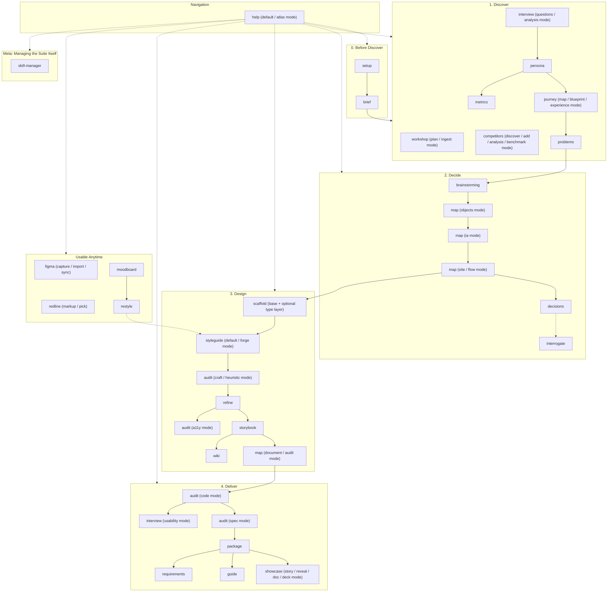

# AGENTS.md: UX Atlas Development & Refinement Guide

Welcome to the **UX Atlas** repository. This document defines the engineering standards, architectural principles, and operational workflows for AI agents (and human contributors) maintaining, refining, and extending this library.

---

## 1. Repository Purpose & Architecture

This repository is the single source of truth for **UX Atlas**, a modular, end-to-end collection of AI Agent Skills designed to power high-craft, interactive prototype creation across UX designers, product designers, and design engineers.

It distills real-world prototyping patterns, two-layer design token architectures, atomic component documentation, visual architecture mapping, and packaging workflows into a portable, standalone skill suite. This folder is meant to be handed to a teammate as-is: every skill works from a fresh clone with `install.sh` and nothing else installed.

The process is **Discover → Decide → Design → Deliver**; see [`help`](skills/help/SKILL.md)'s `atlas` mode and the README for the full narrative flow through each phase. Structurally:



---

## 2. Core Prototyping Principles (Non-Negotiables)

Every skill in this library must uphold these six foundational principles:

### 1. Two-Layer Design Token Discipline
- **Layer 1 (Raw Brand Palette)**: Defined at `:root` in `index.css`. Captures raw brand hex values, grayscales, and RGB status triplets (e.g. `--brand-primary: #00828A; --status-success-rgb: 22 163 74;`).
- **Layer 2 (Semantic Roles)**: Defined in `:root` (light) and rebound under `.dark` (dark mode). Tokens represent UI semantic intent (e.g. `--bg-page`, `--surface`, `--text-primary`, `--action-primary`). See [`styleguide/references/semantic-role-mold.md`](skills/styleguide/references/semantic-role-mold.md) for the full role list.
- **The Golden Rule**: Component JSX code **never** uses hardcoded hex (`#...`), raw Tailwind palette colors (`text-slate-500`, `bg-emerald-600`), or manual `dark:` overrides on auto-flipping tokens (`text-primary dark:text-white` is forbidden). A single semantic class renders properly in both themes!

### 2. Local-First, Zero-Backend Prototyping
- Prototypes exist to validate interaction models, mental journeys, and visual craft without backend friction.
- Avoid real database connections, remote microservices, or external auth providers.
- Use `localStorage`, in-memory React state stores, and realistic deterministic seed fixtures (`shared/seed.ts`).

### 3. 5-Tier Atomic Component Taxonomy
All UI elements must be categorized strictly into:
1. **Foundations**: Design tokens (Colors, Typography, Spacing, Elevation, Radii).
2. **Atoms**: Primitive interactive components (`Button`, `Badge`, `Input`, `Tooltip`, `Icon`).
3. **Molecules**: Simple composite components (`SearchBar`, `FilterDropdown`, `StatCard`, `FormField`).
4. **Organisms**: Complex page regions (`HeaderNav`, `DataTable`, `WorkflowStepCard`, `ModalShell`).
5. **Widgets**: Specialized composite tools (`PrototypeTools`, `ChartWidget`, `ArchitectureMapModal`).

### 4. Self-Documenting Prototypes
Every prototype repository must include a **"Prototype Tools" section inside the user-menu dropdown** containing:
- **Persona Switcher**: Quick-switch user roles/archetypes via React Context, not `localStorage`.
- **Embedded Storybook**: Live in-app iframe/modal viewing static component documentation.
- **UX Architecture Network Map**: Interactive Vis.js modal rendering route and component topology (`map`'s `document` mode).
- **Data Reset**: Optional. Only add a `localStorage` reset control if the prototype actually persists mock data there.

### 5. Standalone & Zero External Dependency
- Skills in this repo must be 100% self-contained. A skill may only reference another skill that also lives in `skills/` in this repo, never a skill installed elsewhere on the author's machine.
- If a pattern is adapted from an external tool or skill, vendor/duplicate the actual content this skill needs directly into its own `references/`, don't just point at the external skill and assume it's there.
- Never require the user's `~/dev` project history, or any other repo, to be present for a skill to function. Those projects may be *mined* for patterns while refining a skill (see §5), but nothing in a skill's shipped instructions should name them or assume access to them.
- **External tools/services are a different category from skill dependencies** and are fine to require explicitly: `npm install vis-network` (`map`'s `document` mode), `npm install docx` / `pptxgenjs` (`showcase`'s `doc`, `deck` and `story` modes), and the Figma MCP server (`figma`'s `import`/`sync` modes, `map`'s optional FigJam export, `requirements`' optional tracker export) are genuine external dependencies every skill using them states up front, not something silently assumed. The rule is about not depending on *another locally-installed skill*, not about avoiding every external tool.

### 6. Unknowns Before Invention
- If a decision genuinely can't be made without real user input, not something inferable from code, docs, or a reasonable default, append a line to `docs/UNKNOWNS.md` (create it if absent) instead of guessing. This applies across the suite: `persona`, `map`, `audit`, `interrogate`, and `styleguide` all defer to this convention rather than inventing an answer. Append it with [`tools/log-unknown`](tools/log-unknown/log-unknown.sh) (`--skill <name> --tier <2|3> [--blocking] "<text>"`) rather than a hand-written line — one consistent format means the file stays queryable later (`--list-blocking` surfaces every open blocking item in one read), not just readable.
- `docs/UNKNOWNS.md` and `DESIGN.md` are a pair: open questions start in `UNKNOWNS.md`; once a concrete, verified answer exists, it's promoted into whichever doc already owns that domain (`DESIGN.md` for visual/token answers, `persona`'s walkthrough, `map`'s `objects`-mode OOUX map, `decisions` for architecture calls) and the line is removed from `UNKNOWNS.md`. An answer with no dedicated home goes to `wiki`.
- [`interview`](../skills/interview/SKILL.md) reads `docs/UNKNOWNS.md` when building the next interview guide, so unknowns raised mid-project naturally get asked about rather than forgotten.

### 7. `docs/` Is a Shorthand, Not a Literal Folder Name
- Every `docs/...` path in this file and in every skill's `SKILL.md` is shorthand for **the project's docs folder**, whichever it's actually named. [`setup`](../skills/setup/SKILL.md) names it `<project-slug>-docs/` (a kebab-case slug of the project name, not a bare `docs/`) so it reads unambiguously as its own vault when opened directly in a third-party tool like Obsidian, instead of showing up as an unlabeled "docs".
- `setup` records the real folder name as the first line of the project's own `AGENTS.md`, before the doc-ownership list. Before creating or reading anything under `docs/...` in a specific project, resolve the real name from that line rather than assuming the literal folder is named `docs`.
- On a project that already had a plain `docs/` folder before this convention existed, `setup` leaves it as-is rather than renaming it out from under other tooling or muscle memory — it only names new folders `<project-slug>-docs/`. Renaming an existing `docs/` is something to ask the user about explicitly, not do silently.

### 8. Output Discipline
Every skill's `SKILL.md` carries an `## Output Discipline` section with one bullet, placed directly after the title/summary header (and the mode list, if the skill has one) and before any flowchart, structure notes, or the first Step/mode heading:

> - Keep chat replies short and bullet-first, docs plain and scannable, and code the simplest version that works (stdlib and native first).

`scripts/validate.mjs` checks the text character for character. A new skill copies it verbatim. The longer, three-bullet form lives once, in the `Working Agreements` block that `setup` writes into each prototype's `AGENTS.md`, so agents that never load a skill still follow it.

### 9. Autonomous Mode: Deciding Without a Human Present
- Every "ask the user" instruction in this suite assumes a human is synchronously available to answer. When a skill runs unattended (an agent driving it asynchronously, no chat turn to wait on), that assumption breaks, and silently picking *something* is worse than the pause it's avoiding. This section defines what replaces the ask.
- **State autonomous mode explicitly at invocation.** An agent driving a skill without a human present says so up front (e.g. "running unattended, no one to ask") rather than a skill inferring it from context. A skill with no such statement behaves exactly as documented — asks, waits.
- **Three tiers, by what's actually at stake if the guess is wrong:**
  1. **Safe default exists (reversible, low-stakes, or the skill already names a "usual" answer)**: take it without pausing. Log the choice in one line — in the chat/session log an agent can review after the fact, or in the doc being produced if it's a fact about the output (e.g. "defaulted to X because Y") — so a human reviewing later sees it was a default, not a considered decision. Most mode-selection asks and scope-narrowing asks fall here.
  2. **Genuinely needs human judgment, but the result is reversible or easy to correct later**: take the most conservative, lowest-commitment option, mark the choice as an assumption needing confirmation (`tools/log-unknown --skill <name> --tier 2 "..."`, per §2.6, worded as a decision made under autonomous mode, not an open question nobody's looked at), and continue. Don't block the rest of the run waiting on it.
  3. **Irreversible, destructive, or wrong-guess corrupts real data** (overwriting a shared external resource, silently resolving a conflict between two real sources, inventing a fact with no source behind it): never guess, autonomous mode or not. Skip that specific step, log it (`tools/log-unknown --skill <name> --tier 3 "..."` — tier 3 is blocking by default), and continue with everything else in the run that doesn't depend on it. This is the same discipline §2.6 already requires of every skill; autonomous mode doesn't relax it, it just replaces "ask" with "skip and log" since there's no one to ask.
- **This is additive to §2.6, not a separate mechanism.** `docs/UNKNOWNS.md` was already the answer for "can't decide, don't invent"; autonomous mode just makes it the default landing spot for every tier-2 and tier-3 decision point instead of a live question.
- A skill that names a specific autonomous-mode default at one of its own ask points (see `audit`, `figma`, `showcase`, `workshop`, `journey`, `styleguide`, `setup`, `help` for examples) is applying this convention concretely; a skill with no such note still falls back to the tiers above by default.
- **Which phase the project is actually in is itself a tier-1 lookup**, not something to re-derive from scratch per skill: [`tools/detect-project-phase`](tools/detect-project-phase/detect-project-phase.sh) resolves the same file-existence signals `help`'s Step 1 table uses (see §3) into a `PHASE=` value. `help`, `interview`, and `setup` all call it rather than re-reading the file system against their own copy of the same table.
- **A UX/product-positioning decision is a checkpoint, not a tier** — orthogonal to the three tiers above, and it doesn't relax even in tier 1. The tiers answer "is this safe enough to guess"; a checkpoint answers a different question: "does the designer running this want to have made this call themselves, even if a guess would've been safe." Which site archetype a scaffold becomes, which competitors anchor a positioning narrative — these shape the actual designed outcome, not just a mechanical detail, so autonomous mode never resolves one on its own. The behind-the-scenes mechanics of building the thing (code hygiene checks, packaging, documenting what's already built) stay fully automated; the decisions that determine *what gets built and how it's positioned* don't.
  - A checkpointed decision is never guessed and never silently defaulted, tier 1 or not. Whatever is driving the work **pauses and asks the human directly before the step that would make the call**, not mid-step and not after — a dispatched background agent has no way to pause and wait once it's running, so the checkpoint has to happen before dispatch, with the resolved answer handed to the agent as part of its instructions.
  - See `agents/coordinator-agent.md` for the concrete mechanism: it resolves every checkpoint live, in conversation, before dispatching the agent whose work depends on the answer.

### 10. Internal Doc Links Are Standard Markdown, Never `[[Wikilinks]]`
- Every cross-reference between docs — skill-to-skill (`skills/*/SKILL.md`), inside a generated project's docs, and inside `wiki`'s own entity pages — uses standard markdown link syntax: `[link text](path.md)`, or `[link text](path.md#section)` to point at a specific section. Both Obsidian and every other markdown tool (GitHub, VS Code, a plain text search) render and follow this syntax; `[[wikilink]]`-style double-bracket links are Obsidian/Logseq-specific and render as literal bracketed text everywhere else, which directly contradicts this suite's "no Obsidian dependency" claim wherever it's made.
- This applies even though `wiki`'s docs describe themselves as building an "interlinked" knowledge base with a graph view — the graph comes from parsing the standard links between pages, not from a special link syntax.

---

## 3. Current Skills Directory

Several skills are **multi-mode**: one skill folder, several named modes for related-but-distinct jobs, rather than separate near-duplicate skills (`audit`, `figma`, `map`, `interview`, `package`, `competitors`, `journey`). Say which mode you want, or the skill asks.

| Skill Folder | Name | Lifecycle Phase | Primary Focus |
|---|---|---|---|
| `skills/help` | `help` | **Router** | **Multi-mode** (the model-invoked front door): default reads the actual repo state and recommends the next 1-3 skills, with reasons and the exact command to run; `atlas` is the full browsable directory & roadmap across the whole Discover→Decide→Design→Deliver process; `doctor` checks the project's docs, tokens, contrast and design rules and names the skill that fixes each problem |
| `skills/setup` | `setup` | **Before Discover** | Bootstraps a prototype repo's doc shell: `README.md`, a project `AGENTS.md`, empty `docs/UNKNOWNS.md`, `docs/notes/`. Also works layered onto an existing product, appending rather than overwriting |
| `skills/brief` | `brief` | **Before Discover** | Interactively interrogates whoever already has the idea (product, audience, user types, core tasks, devices, competitors, constraints); writes `docs/PRODUCT_BRIEF.md`, the domain brief `persona` expects as input. On an existing product, drafts the brief from the codebase first and confirms it instead of a blank interrogation |
| `skills/workshop` | `workshop` | **Discover** | **Multi-mode**: default `plan` (design-thinking workshop: activities, agenda, optional FigJam board/deck, before it happens) or `ingest` (converts photos of the physical workshop board that resulted into a deck, doc, CSV, or replicated FigJam board, after it happens) |
| `skills/competitors` | `competitors` | **Discover** | **Multi-mode**: default `discover` (interrogates market/tool-type/workflows/differentiators one question at a time, researches the web for candidates the stakeholder may not already know about, narrows to the 3-5 closest, profiles each in parallel — features, workflow, UX patterns, a real screenshot) `add` (appends one more competitor found later, without re-running the full scan), `analysis` (deeper, evidence-rated pass by UX category, confidence-tagged, ranked opportunities), or `benchmark` (scores 3-5 products, yours plus competitors and best-in-class from any industry, 1-5 on one rubric with evidence, plus a flow teardown and an adopt/adapt/avoid pattern library). Writes `docs/COMPETITIVE_ANALYSIS.md` (`docs/UX_BENCHMARK.md` for `benchmark`); supersedes `brief`'s competitive-landscape question once run |
| `skills/persona` | `persona` | **Discover** | User archetypes, mental models, & Day in the Life walkthroughs |
| `skills/interview` | `interview` | **Discover / Deliver** | **Multi-mode**: default `questions` (phase-aware question bank + script + synthesis template for user research), `analysis` (turns interview transcripts into evidence-backed themes: verbatim quotes with interview numbers, weak-signal flags, a plan-first gate), `usability` (timed test plan + moderator script for a built prototype: task scenarios, success criteria, bias review, metrics sheet) |
| `skills/journey` | `journey` | **Discover** | **Multi-mode**: `map` (current-state process as a swimlane diagram — as-is, not proposed) or `blueprint` (service-blueprint variant for a customer-facing process: Physical Evidence/Customer/Frontstage/Backstage/Support-Process layers as a time-ordered table, plus duration and handoff wait times) — alternative starting points; `pain-points` (scores friction per step or wait time, severity × frequency, with root cause), `solutions` (fix directions + measurable target per pain point). A fifth mode, `experience`, is a different job: one persona through one scenario, emotions and evidence, every claim cited or `ASSUMPTION`. Writes `docs/JOURNEY_MAP.md` |
| `skills/metrics` | `metrics` | **Discover** | Defines OKRs against a framework matched to the product's medium/adoption model: HEART (opt-in digital), CASTLE (mandatory-use digital, via NN/g), or SELECT (physical tools/services, this suite's own). Every Key Result tagged by category. Writes `docs/OKR.md` |
| `skills/problems` | `problems` | **Discover** | Turns personas, journey maps, interview themes and pain points into problem statements (never with a proposed solution) and prioritised, traceable user stories. Pre-build; `requirements` is the built-prototype counterpart. Writes `docs/PROBLEM_STATEMENTS.md` |
| `skills/brainstorming` | `brainstorming` | **Decide** | Structured ideation against one signed-off problem statement: many ideas, then a scored shortlist of directions (user value, effort, risk), never a single winner. Writes `docs/BRAINSTORM.md` |
| `skills/map` | `map` | **Decide / Design** | **Multi-mode**: `objects` (interactive OOUX/ORCA modeling; seeds `docs/OOUX_OBJECT_MAP.md` + an entity-relationship diagram), `ia` (content, navigation, labelling and search around the user's mental model as a gated, evidence-graded sitemap; content-first, before `site`), `site` (proposed route/component architecture as a diagram, before it's built), `flow` (a complete, evidence-grounded end-to-end user flow for one goal) — all Decide-phase; `audit` (reconciles the object model against built code) and `document` (regenerates the site diagram — Vis.js, Mermaid, SVG — from the real app, plus reconciles the object model if needed) — both Design-phase. Any mode can export to FigJam via the Figma MCP |
| `skills/scaffold` | `scaffold` | **Design** | React 19 + TypeScript + Vite + Tailwind v4 scaffold; base + optional site-type layer (dashboard, chatbot, marketing site, CRM, mobile app) |
| `skills/styleguide` | `styleguide` | **Design** | **Multi-mode**: default (two-layer token architecture, `index.css` + spec-conformant `DESIGN.md`) or `forge` (cast a new brand's palette & fonts into the suite's fixed semantic token roles) |
| `skills/audit` | `audit` | **Design / Deliver** | **Multi-mode** (six): `craft` (scored UX critique task list), `heuristic` (deep Nielsen-heuristic pass, severity-rated 0-4), `code` (coding-standards audit), `spec` (build vs approved design spec, screen by screen), `a11y` (deep WCAG 2.2 AA sweep, incl. mobile and screen readers), `perf` (measured load, interaction and layout-shift numbers against budgets, with causes) |
| `skills/refine` | `refine` | **Design** | Micro-interactions, spacing rhythm, responsive grids, polish |
| `skills/storybook` | `storybook` | **Design** | 5-tier Storybook documentation & in-app viewer embedding |
| `skills/package` | `package` | **Deliver** | Three modes: `full` (site + source + docs handoff zip), `lite` (minified `production/` folder that runs on any static host — backend embedded as a snapshot, edits persisted to localStorage), or `figma` (flat, unminified files each under 1MB, to attach to a Figma Make chat) |
| `skills/showcase` | `showcase` | **Deliver** | **Multi-mode**: `story` (day-in-the-life PowerPoint deck from a prototype: `deck.json` → bundled pptxgenjs builder, Playwright overflow check), `reveal` (reveal.js deck), `doc` (a Markdown report from any suite skill → styled Word document, faithful), `deck` (a Markdown report → condensed PowerPoint, outline confirmed first). Packages the other skills' outputs; never adds content |
| `skills/guide` | `guide` | **Deliver** | End-user documentation: Getting Started + phase-by-phase walkthrough |
| `skills/requirements` | `requirements` | **Deliver** | Reads the built prototype (code, OOUX map, persona doc, ADRs) into a requirements doc: Epics containing Features with user stories and acceptance criteria; optional Jira/ADO export via MCP once connected |
| `skills/decisions` | `decisions` | **Anytime** | Lightweight ADRs capturing a decision and its rejected alternatives |
| `skills/interrogate` | `interrogate` | **Anytime** | Interrogates a design decision one question at a time; hands off to `decisions` |
| `skills/wiki` | `wiki` | **Anytime** | **Multi-mode**: default `compile` (compiles `docs/notes/` and any other document dropped into `docs/` into a small, interlinked, tool-agnostic markdown wiki, incl. a `constellation` graph view) or `note` (quick, low-ceremony capture into `docs/notes/my-notes/` that immediately runs `compile` mode's own ingest step on itself, no separate compile pass needed) |
| `skills/figma` | `figma` | **Anytime** | **Multi-mode**: `capture` (live screen → Figma layers), `import` (Figma frame → convention-conformant code), `sync` (bidirectional token sync with a Figma library) |
| `skills/redline` | `redline` | **Anytime** | **Multi-mode**: `markup` (a marked-up screenshot — circles, arrows, strikethroughs, callouts — becomes one edit per annotation) or `pick` (point at a live element in the running prototype, describe the change). Locates the real source file, edits following this suite's token/tier conventions, no confirm step — reports the diff |
| `skills/moodboard` | `moodboard` | **Anytime** | Maintains a persistent library of visual inspiration (`<docs>/inspiration/`) and synthesizes it into a living `VISUAL_LANGUAGE.md` — recurring color/typography/spacing/shape/elevation patterns plus descriptive adjectives, each citing its source reference. Read by `restyle` as design input |
| `skills/restyle` | `restyle` | **Anytime** | Generates 2-3 full-token-set candidate visual directions from references (or a `moodboard`), live-applies each to the running prototype via a temporary switcher so the designer compares real screens, then hands the chosen direction to `styleguide` `forge` mode to commit for real |
| `skills/skill-manager` | `skill-manager` | **Meta** | Install, delete, disable, enable, list, and sync skills in the shared `~/.agents/skills` library; show what any installed skill does. Sits outside Discover→Decide→Design→Deliver: it manages the skill library itself, not a prototype. |

---

## 4. Skill Authoring & Specification Standard

When creating a new skill or refining an existing one, follow this exact structure:

### File & Directory Layout
```
skills/<skill-name>/
├── SKILL.md              # (Required) Router + shared rules, under 500 lines. Frontmatter.
├── references/           # (Optional) One file per mode, plus guides and specs. One level deep.
├── templates/             # (Optional) Copy-paste boilerplate files (.tsx, .ts, .md)
├── scripts/               # (Optional) Node/Bash helper scripts for automation
└── agents/openai.yaml    # (Generated) Codex UI metadata and invocation policy. Never hand-edit.
```

**Size and loading rules** (checked by `scripts/validate.mjs`; sources: the Agent Skills spec and Anthropic's authoring guide):
- `SKILL.md` stays under 500 lines. A multi-mode skill keeps only the router table and rules shared by all modes in `SKILL.md`, and puts each mode in `references/<mode>.md`. `scripts/split-modes.mjs` does this split. Load one mode per run.
- References link from `SKILL.md` directly. A reference does not send the agent to a second-level reference.
- A reference file over 100 lines starts with a `## Contents` list (`scripts/add-toc.mjs` adds it).
- Paths to tools and other files inside a `SKILL.md` or reference are relative to **that file**. Resolve them from the file's own location, not from the working directory.
- A skill that runs shell tools names the tool by its `../../tools/<name>/` path. The plugin keeps `tools/` beside `skills/`, so the path resolves. `scripts/build-portable.mjs` copies the tools a skill uses into the skill folder for upload targets that take one skill at a time.

### Naming Rule
Skill names in this repo are **single words, no hyphenated compounds, no mandatory prefix** (`persona`, `styleguide`, `audit`). Prefer the single word that most directly names the deliverable or action over a noun-noun compound: `scaffold` not `proto-type`, `package` not `prototype-packaging`. Add a distinguishing prefix, or pick a different word entirely, **only** when the bare word would collide with, or be easily confused with, a different general-purpose skill that commonly lives in a user's global skills folder, and `interrogate` rather than `grill` is exactly that: `grilling`/`grill-with-docs` are common generic skill names. Checking for a collision means actually looking, not guessing at what's likely taken: this suite's packaging skill was first named `handoff` on the theory that `package`/`package-app` was the collision risk, but the real collision turned up later at install time against a genuinely different, already-installed `handoff` skill (conversation compaction), so it got renamed to `package` instead. Both names were plausible in the abstract; only checking the actual target directories (`~/.agents/skills/`, `~/.claude/skills/`, etc.) settles it. When in doubt, check for a name collision before finalizing. A skill that's genuinely 2-3 related-but-distinct jobs sharing one workflow shape should be **one skill with named modes** rather than 2-3 separate single-word skills that would otherwise need near-identical names to stay findable (see `audit` and `figma` in §3). This keeps the single-word rule from forcing artificial compound names onto skill families. Anthropic's authoring guide asks authors to avoid vague or overly generic names, and several suite names are short and generic on purpose (`map`, `package`, `help`, `guide`). The plugin install namespaces them (`/ux-atlas:map`), which removes the collision risk. For a plain-skills install, run the collision check in §6. A user-level skill named `help` can shadow Claude Code's built-in `/help`; prefer the plugin install, where it cannot.

### Frontmatter Schema (`SKILL.md`)
```yaml
---
name: <skill-name>
description: >-
  What the skill does, in the third person, then "Use when ..." with the triggers.
argument-hint: "[mode-a: ~5 word gloss | mode-b: ~5 word gloss]"   # multi-mode skills only
disable-model-invocation: true                                     # user-invoked skills only
---
```

**Description rules.** Third person. At most 1,024 characters (the spec limit; the validator fails above it). Aim for 600 or fewer, because every model-invocable description sits in every session's context. Front-load what the skill is. Give one trigger per branch of use. Do not repeat what the body says.

**`argument-hint`** is the greyed placeholder shown after the user types `/<skill>` in Claude Code. Multi-mode skills list each mode with a gloss of about five words; single-purpose skills omit it. It is not an Agent Skills spec key. Claude.ai and API uploads reject unknown keys, so `scripts/build-portable.mjs` strips it. Claude Code and the plugin accept it.

**Invocation.** A skill is either model-invoked (no flag; its description is in context and the agent can start it) or user-invoked (`disable-model-invocation: true`; the user types it, and it costs no context in Claude Code). Make a skill model-invoked only when the agent must reach it from plain language or another skill must start it. `help` is the model-invoked front door. It reads project state and tells the user the exact command for any user-invoked skill. After changing the flag, run `node scripts/sync-skill-metadata.mjs` so `agents/openai.yaml` (the Codex equivalent) stays in step.

### Required Markdown Sections in `SKILL.md`
1. **Title & Summary Header**: Clean H1 and 1–2 sentence statement of purpose.
2. **Output Discipline**: the one-bullet standard from §2.8, verbatim, directly after the title/summary (and mode list, if any).
3. **Visual Flowchart** (where the skill has multiple decision branches): Mermaid diagram mapping the steps or decision tree.
4. **Step-by-Step Execution Guide**:
   - Clearly numbered steps (`### Step 1: ...` or `## Step 1: ...`).
   - Each step states a goal and, where useful, a concrete artifact or output — see **Goal-Oriented Steps** below for how literal that gets.
   - Explicit **Completion Criterion** for each phase.
5. **Templates & Artifact Specifications**: Full markdown templates or boilerplate structures, stored in this skill's own `templates/` or `references/`, never assumed to live in another skill.

Do not include an "Attribution & Lineage" section or otherwise name source projects/repos in shipped skill content; see §2.5 and §5A.

### Goal-Oriented Steps, Not Rigid Procedures
A step exists to set a goal and a bar for done — not to script the exact sequence of actions an agent must replay verbatim. Default to stating the outcome to reach, why it matters, and how to tell it's done; leave the mechanics (which file to check first, what order to ask questions, exact phrasing of a question) to the agent's judgment in the moment. This isn't a new behavior so much as making explicit what most of this suite's interactive skills (`persona`, `journey`, `audit`, `interrogate`, `help`) already do — reading signals, forming a hypothesis, asking when it's ambiguous — rather than a fixed script.

The exception is real, not rhetorical: when the literal mechanism *is* the constraint — a build that only works with a specific flag, a package name that has to be exact, a token name that has to match a spec character-for-character, a file path a later skill will read from — spell it out verbatim and say why it's non-negotiable. `scaffold`'s install commands, `styleguide`'s token names, and `package`'s zip layout are correctly literal for this reason; don't soften them into vague goals just for style. The test: if two competent agents could satisfy the step in different ways and both outcomes would be fine, write it as a goal. If only one specific way actually works, write that way down exactly.

A step written as "Step 3: run `grep -rn foo bar`" when what actually matters is "confirm every reference to `foo` is gone" should read as the latter — state the goal, and mention the command only as a suggested fast path, not the instruction itself.

### Writing Standard: ASD-STE100
Write all prose in ASD-STE100 (Simplified Technical English). This applies to every chat response, every `SKILL.md`, every doc and every code comment in this repo. The goal is text that is simple, short and clear for readers who are not native English speakers.

- **Sentences:** Use 20 words or fewer in an instruction. Use 25 words or fewer in a description. Make one point in each sentence.
- **Paragraphs:** Keep each paragraph to one topic and six sentences or fewer.
- **Instructions:** Use the imperative ("Open the file."). Give one action in each instruction sentence. Put a warning or note before the step it applies to, not after.
- **Verbs:** Use the active voice. Use only the simple present, simple past, and simple future tenses. Do not use "-ing" forms as verbs.
- **Words:** Use one word for one meaning, and use it the same way each time. Choose the plain word ("use", not "utilize"; "start", not "initiate"). Use the approved word from the ASD-STE100 dictionary when one exists. Technical names (`argument-hint`, `scaffold`, file paths) are allowed. Keep them exactly as they are.
- **Grammar:** Keep the articles ("the", "a"). Do not omit them. Do not use idioms, phrasal verbs with many meanings, or figures of speech. Use lists and tables for steps and comparisons.
- **Exceptions:** Do not change code, commands, quoted source text, or the standard blocks that skills must copy verbatim (such as Output Discipline).

**Scope.** ASD-STE100 is a readability standard for people. No test shows that it improves how well an agent follows a prompt. Apply it in full to docs and chat that people read. In instructions to an agent, apply the sentence-length, active-voice and one-word-one-meaning rules. Where a rule would weaken a leading word that the model already understands well (for example "tracer bullet", "grill", "smart zone"), keep the stronger word and define it once.

When a skill already contains prose that breaks these rules, rewrite it as part of the next change to that skill. Do not make a separate sweep only for style.

### Agent-behavior failure modes (check these in every skill review)
| Failure mode | What to look for | Fix |
|---|---|---|
| **Premature completion** | A step that ends on "done" with no way to tell | Write a completion criterion the agent can check, and make it exhaustive ("every finding mapped to a file") |
| **No-op line** | A sentence the model already obeys by default ("be thorough") | Delete it, or replace it with a stronger word that changes behavior |
| **Negation** | A rule that names the unwanted behavior ("never use X") | State the target behavior; keep a prohibition only as a hard guardrail, paired with what to do instead |
| **Duplication** | The same rule in two files | Keep one source of truth and link to it |
| **Sediment** | Stale layers that nobody dares remove | Prune on every touch |
| **Sprawl** | A long `SKILL.md` where every line is live | Move mode-specific text to `references/` |
| **Over-looping** | A verify step with no pass limit | Bound it: build, check once, fix in one batch, confirm once, stop |

### Prose Hygiene
Before calling a skill (or any doc in this repo) done, check its prose for the tells that make agent-generated writing read as generated rather than considered. This applies to conversational responses about this repo's work too, not just files written to disk.

**Vocabulary and content**
- **Puffery and vague praise** without a concrete referent: "seamless," "robust" (unless it's an actual proper term, e.g. WCAG's Robust principle), "vibrant," "pivotal," "powerful," "game-changing." Say what specifically happens instead.
- **Inflated vocabulary standing in for a plain word**: delve → look into, foster → support/encourage, leverage/utilize → use, facilitate → help, numerous → many, in order to → to, additionally → also, crucial → important, enhance → improve, underscore → show.
- **Abstract jargon nouns that sound technical but say nothing concrete**: substrate, vector, locus, nexus, paradigm, landscape, tapestry, ecosystem (used metaphorically). Name the actual thing instead: "way"/"method" for vector, "area" for landscape.
- **Vague attributions and rule-of-three padding**: "experts believe," "studies show" with no named source; forcing a list into exactly three items when the natural count is two or five.
- **Formulaic hedges and fillers**: "it's worth noting that," "it is important to note," "not just X but Y" used reflexively rather than because the contrast is real; "despite challenges, X continues to thrive."

**Style and punctuation**
- **Decorative em dashes and mid-sentence colons** standing in for a period or a real connective. Use them when they carry an actual aside or consequence, not as a tic. Prefer a period or comma.
- **Fancy ways to say "is"**: "serves as," "stands as," "boasts," "features." Just say "is" or "has."
- **Title Case Headers** where sentence case reads more naturally; excessive bold, especially bold-label-then-colon lines that just restate what follows ("**Performance:** Performance improved..."); decorative emoji in body prose (not the same as an intentional favicon/UI emoji elsewhere); curly quotes where straight ones are the norm in this repo's own files.
- **Chatbot artifacts**: "I hope this helps!," "Let me know if...," "Great question!" Respond directly instead.

**Plain language over jargon**
- Default to the word a person would actually say out loud, not the one that sounds most technical. If a sentence is dense enough that a teammate would ask "wait, what does that mean," restate it the way you'd explain it across a desk: concrete mechanism or number, not a feeling ("the database stays close at hand") or an abstraction.
- Prefer active voice and a real actor over passive constructions ("the compiler validates queries," not "queries are validated") except when the actor genuinely doesn't matter.
- One idea per sentence. If a reader has to backtrack to parse it, split it.
- This is a suite for UX designers and product people, not exclusively engineers; a skill's prose should read as one competent person explaining something to another, not a spec written to impress.

---

## 5. Standard Operating Procedures (SOPs)

### A. How to Refine an Existing Skill
1. **Locate Skill**: Open `skills/<skill-name>/SKILL.md`.
2. **Review Real-World Drift**: Check whether your own recent prototype work has developed a better pattern than what's documented (e.g. improved Tailwind opacity syntax, smarter modal traps, clearer OOUX tables). Mine your own project history for the concrete pattern, but write the *pattern* into the skill, not the project it came from.
3. **Refine Prose & Steps**:
   - Ensure instructions are imperative and crystal clear.
   - Keep code snippets modern (React 19, TypeScript, Tailwind CSS v4 semantic tokens, Lucide icons).
   - Ensure every step has an unambiguous **Completion Criterion**.
4. **Verify Consistency**:
   - Check that no broken relative links exist in `references/` or `templates/`.
   - Ensure token references comply with Layer 1 / Layer 2 standards.
   - Confirm the skill still names zero external projects and zero skills outside this repo (§2.5).
5. **Re-run Installation**: Execute `./install.sh` to refresh symlinks.

### B. How to Create a New Skill
1. **Choose Name**: Follow the Naming Rule in §4: plain name by default, `prototype-` prefix only on collision.
2. **Create Directory**: `mkdir -p skills/<concept-name>`.
3. **Write `SKILL.md`**: Follow the Frontmatter and Section standards in Section 4 above.
4. **Add Supporting Files**: Place any reusable templates or reference docs in `templates/` or `references/`, fully inline, not a pointer to an external skill.
5. **Update Repository Indices (Invariants)**:
   - Add the new skill to the table and Mermaid chart in [README.md](README.md).
   - Add the new skill to the decision tree and directory in [`skills/help/SKILL.md`](skills/help/SKILL.md)'s `atlas` mode.
   - Add the new skill to Section 3 of this document.
6. **Generate and validate**:
   ```bash
   node scripts/sync-skill-metadata.mjs   # writes agents/openai.yaml
   node scripts/build-skill-docs.mjs      # refreshes index.html
   npm test                               # validator, tool tests, Claude's own plugin validator when available
   ```
   Add `evals/<skill>.json` with at least three cases (see `evals/README.md`).
7. **Install & Symlink**:
   ```bash
   cd /Users/aaronkiersky/dev/ux-atlas
   ./install.sh
   ```
8. **Verify Links**: Ensure the hub copy exists in `~/.agents/skills/` and the Claude Code link in `~/.claude/skills/`, and that the new name didn't overwrite an unrelated skill already there. Hub-direct clients (Gemini CLI, Codex, Copilot, Cursor) need no link.

---

## 6. Working Agreements

Patterns that emerged from actually doing rounds of refinement on this repo, durable enough to reuse next time, not a record of any one session. Individual skills carry their own operative rules (dark mode scope, token naming, doc formats); this section is about *how to work on the repo itself*.

### Stress-test scope before building
For anything bigger than a single-skill tweak (new skills, renames, restructuring, absorbing an external pattern), interrogate the request first: one question at a time, each with a stated recommendation, before writing anything. Ambiguity compounds fast across a large skill suite; a few minutes of questions has repeatedly caught boundary problems (overlapping skills, wrong naming, a hidden dependency) before they got built and had to be undone. Don't act until the shared understanding is confirmed back and agreed.

### Verified beats invented
Before writing guidance into a skill, check whether the pattern already exists somewhere real: a project under `~/dev`, an external skill worth adapting, an actual published spec. Mine it, then strip identifying references per §2.5/§5A. Fall back to a reasoned default only when nothing real exists to check against, and say so explicitly rather than presenting a guess as fact.

### Every new skill (or mode) needs an explicit boundary from its neighbors
Before adding a skill or a mode to a multi-mode skill, name what it does *not* do and which existing skill/mode owns that instead, and say so in its own SKILL.md. This repo has several near-miss groups (`audit`'s `craft`/`code`/`a11y` modes; `map`'s `objects`/`site`/`flow`/`audit`/`document` modes, especially `site` vs. `document` (proposed vs. as-built architecture) and `audit` vs. `document` (reconciliation alone vs. reconciliation plus a diagram refresh); `decisions` vs. `interrogate`) that stay distinguishable only because each skill/mode states its boundary explicitly. The names alone aren't enough.

### Living docs, not one-shot outputs
Several docs are meant to be revisited and updated, not generated once and left: `docs/UNKNOWNS.md` (open questions, cleared as they resolve), `docs/OOUX_OBJECT_MAP.md` (seeded in Plan mode, reconciled in Audit mode), `DESIGN.md` (regenerated from `index.css`, never hand-edited out of sync with it). When a new skill touches one of these, extend its existing lifecycle rather than introducing a parallel doc that can drift from it.

### Find, then fix: as two skills, not one
Where work naturally splits into diagnosing and prescribing, keep it as two skills: one finds problems and produces a task list, a second fixes them (`audit`'s `craft` mode → `refine`; the same shape as `audit`'s `a11y` and `code` modes relative to whatever acts on their findings). This keeps "did this actually get better" answerable by just rerunning the finder.

### Related-but-distinct jobs sharing one workflow shape → one skill, named modes
When 2-3 skills would otherwise differ only by *which specific thing* they check/do while sharing the same overall shape (find-and-report, or move-work-to-external-system), merge them into one skill with explicit named modes instead of maintaining near-duplicate skills (`audit`'s `craft`/`code`/`a11y`; `figma`'s `capture`/`import`/`sync`; `styleguide`'s default/`forge` modes — the same `index.css`/`DESIGN.md` pipeline with two different Step-1 sources, not two separate deliverables; `wiki`'s default `compile`/`note` modes — `note` mode's own Step 2 was already just invoking `compile` mode's Step 1 as a subroutine, the same shape as `forge`→`styleguide`; `workshop`'s default `plan`/`ingest` modes — same event, same two possible output shapes (FigJam board, slide deck), built from opposite ends: `plan` before the workshop, `ingest` after it). The mode boundary still needs to be explicit (see above); merging isn't a license to blur what each mode actually checks. Don't force a merge where the jobs *don't* share a shape: `decisions` and `interrogate` stayed separate because one interrogates and the other records, genuinely different verbs, not variations on one job; `storybook` stayed separate from `styleguide` for the same reason — it's an ongoing, separately-scoped deliverable (a whole embedded component-doc site), not a variant Step 1 of the token pipeline.

`map` absorbing `concepting` (`objects`/`site`/`flow`/`audit`/`document` modes) is a different case worth naming explicitly: `concepting` and `map` didn't already share a pipeline the way the pairs above did — they were genuinely different verbs (define the object model via interrogation vs. render structure as a diagram). The merge was a deliberate product decision, not a discovered subroutine coupling: `concepting`'s own ORCA process was always supposed to produce a relationship diagram (its template even had an unused `erDiagram` block), but nothing in its process steps ever rendered one — exactly the gap `map` exists to close. Folding it in put every diagram a prototype needs (object relationships, proposed IA, journeys, as-built architecture) under one skill, with `site` (plan, Decide) and `document` (as-built, Design) as the before/after pair for architecture the same way `workshop`'s `plan`/`ingest` are for a workshop. Don't cite this as precedent for merging two skills just because both happen to produce diagrams or touch the same doc — the actual test is still whether the jobs share a shape (or, as here, whether a real capability gap only closes by putting them in the same place), not topical adjacency.

A contributor's fork added six hyphenated skills in one go (`competitor-analysis`, `ux-benchmark`, `interview-analysis`, `usability-test-plan`, `information-architecture`, `problem-statement`), plus `brainstorming` and a `prototype` rename of `scaffold`. Each was folded in by asking the same two questions: what does it share a workflow shape with, and does it need something that isn't in this repo? `competitors` gained `analysis` (a deeper pass over the same competitor set) and `benchmark` (the scored, any-industry version of the same comparison); `interview` gained `analysis` (after the interviews) and `usability` (a task-based test of a built prototype), with `questions` as the renamed original; `map` gained `ia` (content and navigation structure, content-first before `site`). `problem-statement` did *not* fold into `brief`: `brief` runs before any research exists, while this reads research, so it became `problems`. `scaffold` kept its name: its job is setting things up, and the prototype is built over later prompts. Anything that leaned on separately-installed output skills (`docx`, `xlsx`, `pptx`, `humanizer`) or a skill that didn't exist (`feature-prioritization`) was rewritten to Markdown/CSV (the Word and PowerPoint versions now come from `showcase`'s `doc` and `deck` modes, which declare their own npm dependencies) or had the dangling link removed, per §2.5.

`help` absorbing `router` (as default/`atlas` modes) fits the main pattern above rather than the `map`/`concepting` exception: the two were always a stated pair pointing at each other ("`router` is the full directory... this skill is the 'you are here' pin"), same underlying content (the suite's phase-by-phase map) rendered two ways — situational (default, filtered by repo state) vs. exhaustive (`atlas`, the static directory). No capability gap closed by merging; it's the same "one workflow shape, named modes" case as `workshop`'s `plan`/`ingest`.

### Verification checklist before calling a round done
```bash
npm test                      # = node scripts/validate.mjs && node --test tests/*.test.mjs && node scripts/sync-skill-metadata.mjs --check
node scripts/validate.mjs --warn   # also shows warnings (long descriptions, big SKILL.md files)
claude plugin validate . --strict && claude plugin validate skills --strict && claude plugin validate agents --strict
comm -12 <(ls ~/.agents/skills/ | sort) <(ls skills/ | sort)   # name collision with a skill already in the global folder
grep -rln "<old-name-or-token>" skills/ README.md AGENTS.md      # stale references after a rename or removal
```
`scripts/validate.mjs` checks: frontmatter keys, name equals folder, description length and person, body length, Output Discipline text, every relative link and anchor, every `../tools/` path, `openai.yaml` in step with the invocation flag, every skill listed in the three index docs, the plugin JSON files, and at least three evals per skill.

Then update README.md, `help`'s `atlas` mode, and this file's §3 table together in the same pass; they describe the same suite three ways and must stay in sync (§5B).

### `install.sh` is a real, sometimes-destructive action
The install topology is a hub and spokes: `~/.agents/skills/<name>` is the one real copy, copied from this repo (not symlinked to it), and every client directory selected during install (`~/.claude/skills/`, `~/.gemini/config/skills/`, `~/.cursor/skills/`, etc.) gets a single one-hop symlink to that hub entry. This is the same layout the `skills` CLI produces for other packs on a shared machine (e.g. `setup-matt-pocock-skills`): a real directory in the hub, symlinks everywhere else. Don't add a client that links straight to `$SOURCE_DIR`. Because the hub is a copy, edits in this repo don't reach installed clients until `./install.sh` is re-run. Four clients stay in the picker so nobody hunts for them, but selecting them is deliberately a no-op: Gemini CLI, OpenAI Codex, GitHub Copilot and Cursor read `~/.agents/skills/` directly (checked against each product's skills docs), so the hub copy alone reaches them. A second link only makes every skill appear twice (Gemini prints a "Skill conflict detected" notice per skill; Cursor also reads `~/.claude/skills/` and `~/.codex/skills/`). The installer removes any such link earlier versions of it created (checked via `readlink` first). Don't "fix" the no-op by linking. Claude Code does not read the hub, so it keeps its link. The installer also copies `agents/*.md` to `~/.agents/agents/` and links them into `~/.claude/agents/`.

The Claude Code plugin (`.claude-plugin/`) is the preferred install for a team: it namespaces skills as `/ux-atlas:<skill>`, ships `tools/` and `agents/` with the skills, and updates from the marketplace. Do not use the plugin and `install.sh --claude` together: every skill would appear twice. `install.sh` warns when it sees both.

It tracks what it installed in `~/.agents/skills/.ux-atlas.manifest` and diffs against the current `skills/` directory on every run, so a rename or delete *does* get cleaned up automatically: the hub copy is removed outright (the manifest is the proof it was ours), and a client entry is removed only if `readlink` shows it's our symlink, never a real directory or another pack's link. Installing a skill whose name matches something already at `~/.agents/skills/<name>` still overwrites it outright (a plain `rm -rf` before the `cp -R`, no manifest check), so a name collision with a personal skill someone already had there is the one case that isn't self-healing. Confirm with the user before running it when a round included a rename that might collide with something not originally authored in this repo.

