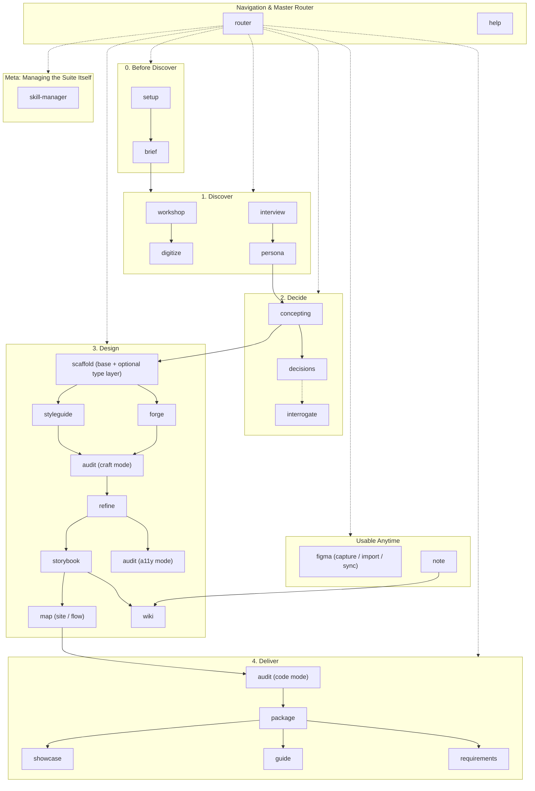

# AGENTS.md: UX Atlas Development & Refinement Guide

Welcome to the **UX Atlas** repository. This document defines the engineering standards, architectural principles, and operational workflows for AI agents (and human contributors) maintaining, refining, and extending this library.

---

## 1. Repository Purpose & Architecture

This repository is the single source of truth for **UX Atlas**, a modular, end-to-end collection of AI Agent Skills designed to power high-craft, interactive prototype creation across UX designers, product designers, and design engineers.

It distills real-world prototyping patterns, two-layer design token architectures, atomic component documentation, visual architecture mapping, and packaging workflows into a portable, standalone skill suite. This folder is meant to be handed to a teammate as-is: every skill works from a fresh clone with `install.sh` and nothing else installed.

The process is **Discover → Decide → Design → Deliver**; see [`router`](skills/router/SKILL.md) and the README for the full narrative flow through each phase. Structurally:



---

## 2. Core Prototyping Principles (Non-Negotiables)

Every skill in this library must uphold these six foundational principles:

### 1. Two-Layer Design Token Discipline
- **Layer 1 (Raw Brand Palette)**: Defined at `:root` in `index.css`. Captures raw brand hex values, grayscales, and RGB status triplets (e.g. `--brand-primary: #00828A; --status-success-rgb: 22 163 74;`).
- **Layer 2 (Semantic Roles)**: Defined in `:root` (light) and rebound under `.dark` (dark mode). Tokens represent UI semantic intent (e.g. `--bg-page`, `--surface`, `--text-primary`, `--action-primary`). See [`forge/references/semantic-role-mold.md`](skills/forge/references/semantic-role-mold.md) for the full role list.
- **The Golden Rule**: Component JSX code **never** uses hardcoded hex (`#...`), raw Tailwind palette colors (`text-slate-500`, `bg-emerald-600`), or manual `dark:` overrides on auto-flipping tokens (`text-primary dark:text-white` is forbidden). A single semantic class renders properly in both themes!

### 2. Local-First, Zero-Backend Prototyping
- Prototypes exist to validate interaction models, mental journeys, and visual craft without backend friction.
- Avoid real database connections, remote microservices, or external auth providers.
- Use `localStorage`, in-memory React state stores, and realistic deterministic seed fixtures (`shared/seed.ts`).

### 3. 5-Tier Atomic Component Taxonomy
All UI elements must be categorized strictly into:
1. **Foundations**: Design tokens (Colors, Typography, Spacing, Elevation, Radii).
2. **Atoms**: Primitive interactive components (`Button`, `Badge`, `Input`, `Tooltip`, `Icon`).
3. **Molecules**: Simple composite components (`SearchBar`, `FilterDropdown`, `StatCard`, `FormField`).
4. **Organisms**: Complex page regions (`HeaderNav`, `DataTable`, `WorkflowStepCard`, `ModalShell`).
5. **Widgets**: Specialized composite tools (`PrototypeTools`, `ChartWidget`, `ArchitectureMapModal`).

### 4. Self-Documenting Prototypes
Every prototype repository must include a **"Prototype Tools" section inside the user-menu dropdown** containing:
- **Persona Switcher**: Quick-switch user roles/archetypes via React Context, not `localStorage`.
- **Embedded Storybook**: Live in-app iframe/modal viewing static component documentation.
- **UX Architecture Network Map**: Interactive Vis.js modal rendering route and component topology (`map`'s `site` mode).
- **Data Reset**: Optional. Only add a `localStorage` reset control if the prototype actually persists mock data there.

### 5. Standalone & Zero External Dependency
- Skills in this repo must be 100% self-contained. A skill may only reference another skill that also lives in `skills/` in this repo, never a skill installed elsewhere on the author's machine.
- If a pattern is adapted from an external tool or skill, vendor/duplicate the actual content this skill needs directly into its own `references/`, don't just point at the external skill and assume it's there.
- Never require the user's `~/dev` project history, or any other repo, to be present for a skill to function. Those projects may be *mined* for patterns while refining a skill (see §5), but nothing in a skill's shipped instructions should name them or assume access to them.
- **External tools/services are a different category from skill dependencies** and are fine to require explicitly: `npm install vis-network` (`map`'s `site` mode), and the Figma MCP server (`figma`'s `import`/`sync` modes, `map`'s optional FigJam export, `requirements`' optional tracker export) are genuine external dependencies every skill using them states up front, not something silently assumed. The rule is about not depending on *another locally-installed skill*, not about avoiding every external tool.

### 6. Unknowns Before Invention
- If a decision genuinely can't be made without real user input, not something inferable from code, docs, or a reasonable default, append a line to `docs/UNKNOWNS.md` (create it if absent) instead of guessing. This applies across the suite: `persona`, `concepting`, `audit`, `interrogate`, and `styleguide` all defer to this convention rather than inventing an answer.
- `docs/UNKNOWNS.md` and `DESIGN.md` are a pair: open questions start in `UNKNOWNS.md`; once a concrete, verified answer exists, it's promoted into whichever doc already owns that domain (`DESIGN.md` for visual/token answers, `persona`'s walkthrough, `concepting`'s OOUX map, `decisions` for architecture calls) and the line is removed from `UNKNOWNS.md`. An answer with no dedicated home goes to `wiki`.
- [`interview`](../skills/interview/SKILL.md) reads `docs/UNKNOWNS.md` when building the next interview guide, so unknowns raised mid-project naturally get asked about rather than forgotten.

---

## 3. Current Skills Directory

Several skills are **multi-mode**: one skill folder, several named modes for related-but-distinct jobs, rather than separate near-duplicate skills (`audit`, `figma`, `concepting`, `interview`, `package`). Say which mode you want, or the skill asks.

| Skill Folder | Name | Lifecycle Phase | Primary Focus |
|---|---|---|---|
| `skills/router` | `router` | **Router** | Interactive guide & roadmap across the whole Discover→Decide→Design→Deliver process |
| `skills/help` | `help` | **Router** | Reads the actual repo state and recommends the next 1-3 skills, with reasons; the situational counterpart to `router` |
| `skills/setup` | `setup` | **Before Discover** | Bootstraps a prototype repo's doc shell: `README.md`, a project `AGENTS.md`, empty `docs/UNKNOWNS.md`, `docs/notes/`. Also works layered onto an existing product, appending rather than overwriting |
| `skills/brief` | `brief` | **Before Discover** | Interactively interrogates whoever already has the idea (product, audience, user types, core tasks, devices, competitors, constraints); writes `docs/PRODUCT_BRIEF.md`, the domain brief `persona` expects as input. On an existing product, drafts the brief from the codebase first and confirms it instead of a blank interrogation |
| `skills/workshop` | `workshop` | **Discover** | Plans a design-thinking workshop: activities, agenda, optional FigJam board/deck |
| `skills/digitize` | `digitize` | **Discover** | Converts photos of a physical workshop board into a deck, doc, CSV, or replicated FigJam board |
| `skills/persona` | `persona` | **Discover** | User archetypes, mental models, & Day in the Life walkthroughs |
| `skills/interview` | `interview` | **Discover / Deliver** | Phase-aware question bank + script + synthesis template for user research |
| `skills/concepting` | `concepting` | **Decide** | Interactive OOUX/ORCA modeling; Plan mode seeds it, Audit mode reconciles against the build |
| `skills/scaffold` | `scaffold` | **Design** | React 19 + TypeScript + Vite + Tailwind scaffold; base + optional site-type layer (dashboard, chatbot, marketing site, CRM) |
| `skills/styleguide` | `styleguide` | **Design** | Two-layer token architecture (`index.css` + spec-conformant `DESIGN.md`) |
| `skills/forge` | `forge` | **Design** | Cast a new brand's palette & fonts into the suite's fixed semantic token roles |
| `skills/audit` | `audit` | **Design / Deliver** | **Multi-mode**: `craft` (scored UX critique task list), `code` (coding-standards audit), `a11y` (deep WCAG 2.1/2.2 AA sweep) |
| `skills/refine` | `refine` | **Design** | Micro-interactions, spacing rhythm, responsive grids, polish |
| `skills/storybook` | `storybook` | **Design** | 5-tier Storybook documentation & in-app viewer embedding |
| `skills/map` | `map` | **Design** | **Multi-mode**: `site` (route/component graph: interactive Vis.js, Mermaid, SVG) or `flow` (persona journey/branching workflow as Mermaid); either can export to FigJam via the Figma MCP |
| `skills/package` | `package` | **Deliver** | Two modes: `full` (site + source + docs handoff zip) or `lite` (minified `production/` folder only) |
| `skills/showcase` | `showcase` | **Deliver** | Shareable presentation from a prototype: PDF/PowerPoint or reveal.js deck |
| `skills/guide` | `guide` | **Deliver** | End-user documentation: Getting Started + phase-by-phase walkthrough |
| `skills/requirements` | `requirements` | **Deliver** | Reads the built prototype (code, OOUX map, persona doc, ADRs) into a requirements doc: Epics containing Features with user stories and acceptance criteria; optional Jira/ADO export via MCP once connected |
| `skills/decisions` | `decisions` | **Anytime** | Lightweight ADRs capturing a decision and its rejected alternatives |
| `skills/note` | `note` | **Anytime** | Quick, low-ceremony capture (an idea, a risk, a "don't forget this") into `docs/notes/my-notes/` that immediately runs `wiki`'s own ingest step on itself, no separate compile pass needed |
| `skills/interrogate` | `interrogate` | **Anytime** | Interrogates a design decision one question at a time; hands off to `decisions` |
| `skills/wiki` | `wiki` | **Anytime** | Compiles `docs/notes/` and any other document dropped into `docs/` into a small, interlinked, tool-agnostic markdown wiki, incl. a `constellation` graph view |
| `skills/figma` | `figma` | **Anytime** | **Multi-mode**: `capture` (live screen → Figma layers), `import` (Figma frame → convention-conformant code), `sync` (bidirectional token sync with a Figma library) |
| `skills/skill-manager` | `skill-manager` | **Meta** | Install, delete, disable, enable, list, and sync skills in the shared `~/.agents/skills` library; show what any installed skill does. Sits outside Discover→Decide→Design→Deliver: it manages the skill library itself, not a prototype. |

---

## 4. Skill Authoring & Specification Standard

When creating a new skill or refining an existing one, follow this exact structure:

### File & Directory Layout
```
skills/<skill-name>/
├── SKILL.md              # (Required) Main skill instructions & frontmatter
├── references/           # (Optional) Detailed guides, token sheets, domain specs
├── templates/             # (Optional) Copy-paste boilerplate files (.tsx, .ts, .md)
└── scripts/               # (Optional) Node/Bash helper scripts for automation
```

### Naming Rule
Skill names in this repo are **single words, no hyphenated compounds, no mandatory prefix** (`persona`, `styleguide`, `audit`). Prefer the single word that most directly names the deliverable or action over a noun-noun compound: `scaffold` not `proto-type`, `package` not `prototype-packaging`. Add a distinguishing prefix, or pick a different word entirely, **only** when the bare word would collide with, or be easily confused with, a different general-purpose skill that commonly lives in a user's global skills folder, and `interrogate` rather than `grill` is exactly that: `grilling`/`grill-with-docs` are common generic skill names. Checking for a collision means actually looking, not guessing at what's likely taken: this suite's packaging skill was first named `handoff` on the theory that `package`/`package-app` was the collision risk, but the real collision turned up later at install time against a genuinely different, already-installed `handoff` skill (conversation compaction), so it got renamed to `package` instead. Both names were plausible in the abstract; only checking the actual target directories (`~/.agents/skills/`, `~/.claude/skills/`, etc.) settles it. When in doubt, check for a name collision before finalizing. A skill that's genuinely 2-3 related-but-distinct jobs sharing one workflow shape should be **one skill with named modes** rather than 2-3 separate single-word skills that would otherwise need near-identical names to stay findable (see `audit` and `figma` in §3). This keeps the single-word rule from forcing artificial compound names onto skill families.

### Frontmatter Schema (`SKILL.md`)
```yaml
---
name: <skill-name>
description: Precise summary of what the skill does and when to use it. Include explicit triggers ("Use when user asks to...", "create persona", etc.).
disable-model-invocation: true # Set to true for user-initiated workflows / slash commands
---
```

### Required Markdown Sections in `SKILL.md`
1. **Title & Summary Header**: Clean H1 and 1–2 sentence statement of purpose.
2. **Visual Flowchart** (where the skill has multiple decision branches): Mermaid diagram mapping the steps or decision tree.
3. **Step-by-Step Execution Guide**:
   - Clearly numbered steps (`### Step 1: ...` or `## Step 1: ...`).
   - Copy-paste ready CLI commands and code snippets.
   - Explicit **Completion Criterion** for each phase.
4. **Templates & Artifact Specifications**: Full markdown templates or boilerplate structures, stored in this skill's own `templates/` or `references/`, never assumed to live in another skill.

Do not include an "Attribution & Lineage" section or otherwise name source projects/repos in shipped skill content; see §2.5 and §5A.

### Prose Hygiene
Before calling a skill (or any doc in this repo) done, check its prose for the tells that make agent-generated writing read as generated rather than considered. This applies to conversational responses about this repo's work too, not just files written to disk.

**Vocabulary and content**
- **Puffery and vague praise** without a concrete referent: "seamless," "robust" (unless it's an actual proper term, e.g. WCAG's Robust principle), "vibrant," "pivotal," "powerful," "game-changing." Say what specifically happens instead.
- **Inflated vocabulary standing in for a plain word**: delve → look into, foster → support/encourage, leverage/utilize → use, facilitate → help, numerous → many, in order to → to, additionally → also, crucial → important, enhance → improve, underscore → show.
- **Abstract jargon nouns that sound technical but say nothing concrete**: substrate, vector, locus, nexus, paradigm, landscape, tapestry, ecosystem (used metaphorically). Name the actual thing instead: "way"/"method" for vector, "area" for landscape.
- **Vague attributions and rule-of-three padding**: "experts believe," "studies show" with no named source; forcing a list into exactly three items when the natural count is two or five.
- **Formulaic hedges and fillers**: "it's worth noting that," "it is important to note," "not just X but Y" used reflexively rather than because the contrast is real; "despite challenges, X continues to thrive."

**Style and punctuation**
- **Decorative em dashes and mid-sentence colons** standing in for a period or a real connective. Use them when they carry an actual aside or consequence, not as a tic. Prefer a period or comma.
- **Fancy ways to say "is"**: "serves as," "stands as," "boasts," "features." Just say "is" or "has."
- **Title Case Headers** where sentence case reads more naturally; excessive bold, especially bold-label-then-colon lines that just restate what follows ("**Performance:** Performance improved..."); decorative emoji in body prose (not the same as an intentional favicon/UI emoji elsewhere); curly quotes where straight ones are the norm in this repo's own files.
- **Chatbot artifacts**: "I hope this helps!," "Let me know if...," "Great question!" Respond directly instead.

**Plain language over jargon**
- Default to the word a person would actually say out loud, not the one that sounds most technical. If a sentence is dense enough that a teammate would ask "wait, what does that mean," restate it the way you'd explain it across a desk: concrete mechanism or number, not a feeling ("the database stays close at hand") or an abstraction.
- Prefer active voice and a real actor over passive constructions ("the compiler validates queries," not "queries are validated") except when the actor genuinely doesn't matter.
- One idea per sentence. If a reader has to backtrack to parse it, split it.
- This is a suite for UX designers and product people, not exclusively engineers; a skill's prose should read as one competent person explaining something to another, not a spec written to impress.

---

## 5. Standard Operating Procedures (SOPs)

### A. How to Refine an Existing Skill
1. **Locate Skill**: Open `skills/<skill-name>/SKILL.md`.
2. **Review Real-World Drift**: Check whether your own recent prototype work has developed a better pattern than what's documented (e.g. improved Tailwind opacity syntax, smarter modal traps, clearer OOUX tables). Mine your own project history for the concrete pattern, but write the *pattern* into the skill, not the project it came from.
3. **Refine Prose & Steps**:
   - Ensure instructions are imperative and crystal clear.
   - Keep code snippets modern (React 19, TypeScript, Tailwind CSS v3 semantic tokens, Lucide icons).
   - Ensure every step has an unambiguous **Completion Criterion**.
4. **Verify Consistency**:
   - Check that no broken relative links exist in `references/` or `templates/`.
   - Ensure token references comply with Layer 1 / Layer 2 standards.
   - Confirm the skill still names zero external projects and zero skills outside this repo (§2.5).
5. **Re-run Installation**: Execute `./install.sh` to refresh symlinks.

### B. How to Create a New Skill
1. **Choose Name**: Follow the Naming Rule in §4: plain name by default, `prototype-` prefix only on collision.
2. **Create Directory**: `mkdir -p skills/<concept-name>`.
3. **Write `SKILL.md`**: Follow the Frontmatter and Section standards in Section 4 above.
4. **Add Supporting Files**: Place any reusable templates or reference docs in `templates/` or `references/`, fully inline, not a pointer to an external skill.
5. **Update Repository Indices (Invariants)**:
   - Add the new skill to the table and Mermaid chart in [README.md](README.md).
   - Add the new skill to the decision tree and directory in [`skills/router/SKILL.md`](skills/router/SKILL.md).
   - Add the new skill to Section 3 of this document.
6. **Install & Symlink**:
   ```bash
   cd /Users/aaronkiersky/dev/ux-atlas
   ./install.sh
   ```
7. **Verify Links**: Ensure symlinks exist in `~/.agents/skills/` and `~/.gemini/config/skills/`, and that the new name didn't overwrite an unrelated skill already there.

---

## 6. Working Agreements

Patterns that emerged from actually doing rounds of refinement on this repo, durable enough to reuse next time, not a record of any one session. Individual skills carry their own operative rules (dark mode scope, token naming, doc formats); this section is about *how to work on the repo itself*.

### Stress-test scope before building
For anything bigger than a single-skill tweak (new skills, renames, restructuring, absorbing an external pattern), interrogate the request first: one question at a time, each with a stated recommendation, before writing anything. Ambiguity compounds fast across a large skill suite; a few minutes of questions has repeatedly caught boundary problems (overlapping skills, wrong naming, a hidden dependency) before they got built and had to be undone. Don't act until the shared understanding is confirmed back and agreed.

### Verified beats invented
Before writing guidance into a skill, check whether the pattern already exists somewhere real: a project under `~/dev`, an external skill worth adapting, an actual published spec. Mine it, then strip identifying references per §2.5/§5A. Fall back to a reasoned default only when nothing real exists to check against, and say so explicitly rather than presenting a guess as fact.

### Every new skill (or mode) needs an explicit boundary from its neighbors
Before adding a skill or a mode to a multi-mode skill, name what it does *not* do and which existing skill/mode owns that instead, and say so in its own SKILL.md. This repo has several near-miss groups (`audit`'s `craft`/`code`/`a11y` modes; `map`'s `site` vs. `flow` modes; `decisions` vs. `interrogate`) that stay distinguishable only because each skill/mode states its boundary explicitly. The names alone aren't enough.

### Living docs, not one-shot outputs
Several docs are meant to be revisited and updated, not generated once and left: `docs/UNKNOWNS.md` (open questions, cleared as they resolve), `docs/OOUX_OBJECT_MAP.md` (seeded in Plan mode, reconciled in Audit mode), `DESIGN.md` (regenerated from `index.css`, never hand-edited out of sync with it). When a new skill touches one of these, extend its existing lifecycle rather than introducing a parallel doc that can drift from it.

### Find, then fix: as two skills, not one
Where work naturally splits into diagnosing and prescribing, keep it as two skills: one finds problems and produces a task list, a second fixes them (`audit`'s `craft` mode → `refine`; the same shape as `audit`'s `a11y` and `code` modes relative to whatever acts on their findings). This keeps "did this actually get better" answerable by just rerunning the finder.

### Related-but-distinct jobs sharing one workflow shape → one skill, named modes
When 2-3 skills would otherwise differ only by *which specific thing* they check/do while sharing the same overall shape (find-and-report, or move-work-to-external-system), merge them into one skill with explicit named modes instead of maintaining near-duplicate skills (`audit`'s `craft`/`code`/`a11y`; `figma`'s `capture`/`import`/`sync`). The mode boundary still needs to be explicit (see above); merging isn't a license to blur what each mode actually checks. Don't force a merge where the jobs *don't* share a shape: `decisions` and `interrogate` stayed separate because one interrogates and the other records, genuinely different verbs, not variations on one job.

### Verification checklist before calling a round done
```bash
# frontmatter name matches folder name
for d in skills/*/; do
  name=$(basename "$d"); fm=$(grep -m1 "^name:" "$d/SKILL.md" | sed 's/name: //')
  [ "$name" != "$fm" ] && echo "MISMATCH: $name vs $fm"
done

# no broken cross-skill links
for f in skills/*/SKILL.md; do
  grep -oE '\.\./[a-z0-9-]+/(SKILL\.md|references/[a-zA-Z0-9._-]+\.md|templates/[a-zA-Z0-9._-]+\.[a-z]+)' "$f" | while read -r rel; do
    dir=$(dirname "$f"); [ -f "$dir/$rel" ] || echo "BROKEN: $f -> $rel"
  done
done

# no collision with a name already in the global skills folder
comm -12 <(ls ~/.agents/skills/ | sort) <(ls skills/ | sort)

# no stale references left behind by a rename/removal
grep -rln "<old-name-or-token>" skills/ README.md AGENTS.md
```
Then update README.md, `router`, and this file's §3 table together in the same pass; they describe the same suite three ways and must stay in sync (§5B).

### `install.sh` is a real, sometimes-destructive action
The install topology is a hub and spokes: `~/.agents/skills/<name>` is the one real symlink into this repo, and every client directory it manages (`~/.claude/skills/`, `~/.gemini/skills/`, `~/.gemini/config/skills/`) gets a symlink chained to that hub entry, not a second direct link to the repo. This matches how other, unrelated skill packs are typically wired on a shared machine (one real copy, everything else pointing at it), so don't add a client that links straight to `$SOURCE_DIR` instead of the hub.

It tracks what it installed in `~/.agents/skills/.ux-atlas.manifest` and diffs against the current `skills/` directory on every run, so a rename or delete *does* get cleaned up automatically now, but only for entries the manifest confirms this repo actually created (checked via `readlink` before any `rm`). It will never remove a real directory or an unrelated pack's symlink that happens to share a client folder. Installing a skill whose name matches something already at `~/.agents/skills/<name>` still overwrites it outright (that's a plain `rm -rf` before the `ln -s`, no manifest check), so a name collision with a personal skill someone already had there is the one case that isn't self-healing. Confirm with the user before running it when a round included a rename that might collide with something not originally authored in this repo.
