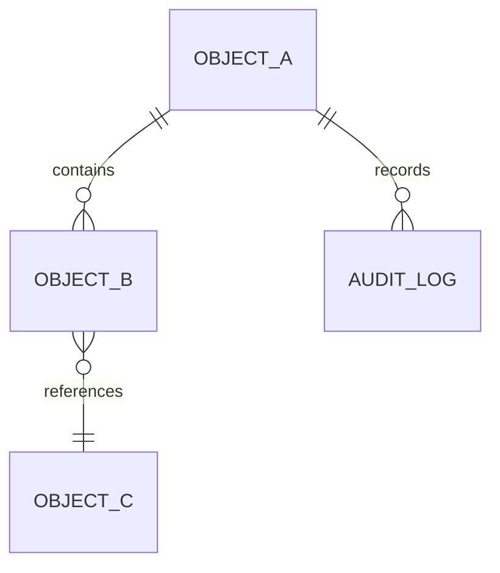

# OOUX Object Map & Feature Specification

## 1. Domain Object Inventory

| Object Name | Description | Key Roles / Owners | Primary Surface / View |
|---|---|---|---|
| **[Object A]** | [Description] | [Owner Role] | `[ViewName]View.tsx` |
| **[Object B]** | [Description] | [Owner Role] | `[ViewName]View.tsx` |

---

## 2. Object Relationship Matrix



---

## 3. Calls to Action (CTA) & State Machine

### Object: `[Object A]`

| State | Available CTAs | Actor Role | Next State | System Side Effects |
|---|---|---|---|---|
| `Draft` | `SubmitForReview` | Submitter | `InReview` | Notify Tier 1 reviewers, timestamp |
| `InReview` | `Approve` | Reviewer | `Approved` | Check all tiers complete, lock changes |
| `InReview` | `RequestChanges` | Reviewer | `NeedsInfo` | Open comment thread, unblock editing |
| `Approved` | `Archive` | Admin | `Archived` | Read-only mode |

---

## 4. TypeScript Interface Blueprint (`shared/types.ts`)

```typescript
export type WorkflowStatus = 'draft' | 'in_review' | 'approved' | 'rejected' | 'needs_info';

export interface [ObjectA] {
  id: string;
  title: string;
  status: WorkflowStatus;
  createdAt: string;
  updatedAt: string;
  author: {
    id: string;
    name: string;
    avatarUrl?: string;
  };
  metadata: {
    riskTier: 'low' | 'medium' | 'high';
    tags: string[];
  };
}
```
