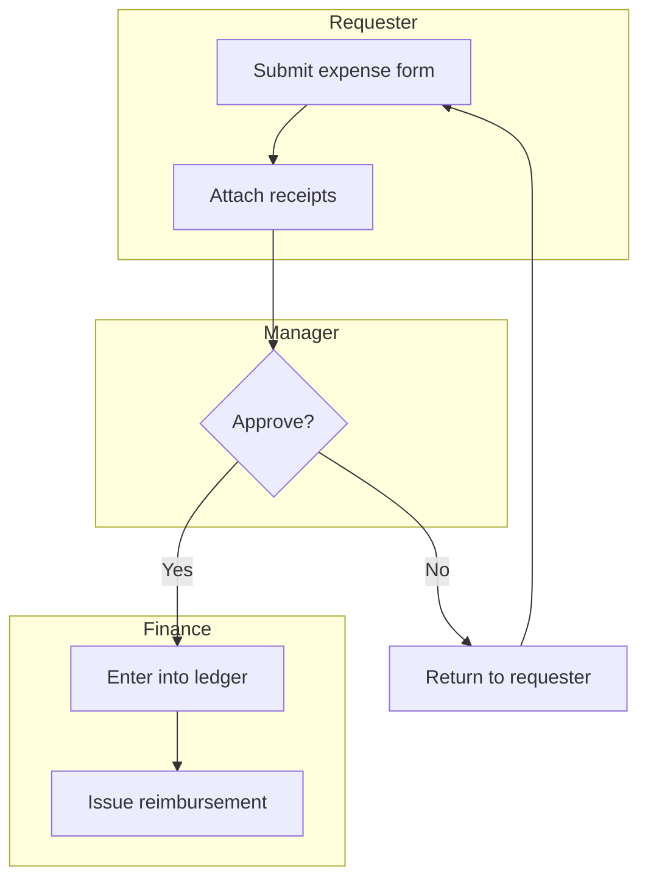

# Journey Mapping

Five modes, two different jobs sharing one skill because they're the same *shape* of work — trace a sequence, find where it hurts, evidence every claim — even though `map`/`blueprint`/`pain-points`/`solutions` and `experience` map genuinely different subjects.

- **`map`** (default): the *process* as it exists today — actors, steps, handoffs, systems touched — as a swimlane diagram. `docs/JOURNEY_MAP.md`.
- **`blueprint`**: alternative to `map` for a customer-facing service process where the frontstage/backstage split and cross-team handoff timing are the point.
- **`pain-points`**: for each step, score real friction (severity × frequency) and its root cause. Needs a current-state diagram from `map` or `blueprint`.
- **`solutions`**: for the pain points worth acting on, explore fix directions and set a measurable target.
- **`experience`**: one *persona* through one specific scenario — actions, thoughts, emotions, pain points and opportunities per stage, an emotion curve, every claim cited or marked `ASSUMPTION`. `docs/CUSTOMER_JOURNEY.md`. Does not require `map`/`blueprint` to have run first — it's a different subject, not a later stage of the same one.

Say which mode, or this skill asks. `map` and `blueprint` are alternative starting points for the *process* track, not sequential to each other; `pain-points` and `solutions` build on whichever was used. `experience` is independent of all four — pick it directly when the question is "what does this feel like for one user," not "how does this process actually run."

**Not this skill:**
- A single persona's whole day across many tasks and tools, narrative-driven, feeding screen/scene design → [`persona`](../persona/SKILL.md)'s `day` mode. Persona is about a *person's whole day*; `journey`'s `experience` mode is about *one scenario*, with an emotion curve and per-stage evidence discipline `persona` doesn't have.
- A proposed or future-state workflow (what should happen once something's built) → [`map`](../map/SKILL.md)'s `flow` mode. `journey`'s `map` mode is deliberately as-is; if the process being diagrammed doesn't exist yet, that's `flow` mode, not this.
- Modeling objects/CTAs for something being built → [`map`](../map/SKILL.md)'s `objects` mode, which `journey`'s `solutions` mode hands off to once a fix direction is picked.
- Setting the metrics/targets a whole project is accountable to → [`metrics`](../metrics/SKILL.md). `journey`'s `solutions` mode proposes per-pain-point targets as candidate Key Results; `metrics` is where they get framed against a chosen framework and tracked.
- Turning `experience`'s findings into a backlog → [`problems`](../problems/SKILL.md), which reads this skill's output as one of its inputs.

---

## Output Discipline
- Chat: short, bullets over paragraphs, no recap of what you're about to do — just the result. Expand only if asked.
- Docs this skill writes: plain, scannable prose at the depth its template calls for — cut padding, keep substance.
- Code this skill writes: simplest version that works — stdlib/native first, no speculative abstractions, no unrequested scaffolding.

## Mode: map

### Step 1: Identify the process and its boundary

Ask (don't assume): what process, where does it start and end, and who's the primary actor whose journey this traces. A process without a clear start/end trigger ("handling customer requests" is too broad; "a support ticket from submission to resolution" has a boundary) produces an unusable diagram — narrow it before mapping.

### Step 2: Walk the steps interactively

Same discipline as [`interrogate`](../interrogate/SKILL.md) and `map`'s `objects` mode: one step at a time, confirm before moving on, don't invent steps nobody described. For each step, capture:
- **Actor/lane**: who does this step (a role, not a person's name)
- **Action**: what actually happens, in plain language
- **System(s) touched**: tools, forms, spreadsheets, approvals — whatever's actually used, including informal ones ("a Slack DM to the manager" is a real system if that's how it actually works)
- **Handoff**: what moves to the next actor, and how (an email, a status change, a physical form)

Capture the process **as it actually runs**, including workarounds and informal steps nobody put in a manual — that's usually where `pain-points` mode finds the most. Don't smooth it into how it's supposed to work on paper.

### Step 3: Build the swimlane diagram

Render as Mermaid `flowchart TD`, one subgraph per actor/lane (same subgraph-by-group technique as `map`'s `site` mode):



Keep node labels to the action, not the full narrative (3-6 words, matching `map`'s `flow` mode convention). Write to `docs/JOURNEY_MAP.md` under a `## Current State` heading, with a one-line caption noting the process boundary from Step 1. Use [`templates/journey-map-template.md`](templates/journey-map-template.md) for the full document shape (all three sections; `pain-points` and `solutions` modes append to the same file).

**Completion criterion:** every step traces to something the actor actually confirmed happens (not assumed or idealized), every actor has their own lane, and the diagram's handoffs match what Step 2 captured.

---

## Mode: blueprint

The service-blueprint variant of `map`: same as-is discipline, but for a customer-facing process where *what the customer sees vs. what happens behind the scenes* and *how long each handoff actually takes* are the point — a plain actor-lane swimlane loses both.

### Step 1: Confirm this is the right mode

Ask if it's not already obvious: does this process have a real customer (or end-user) facing side, with work also happening behind the scenes across multiple teams/systems, where the timing of handoffs between them matters? If it's a single-team internal process with no real frontstage/backstage split, `map` mode is simpler and loses nothing — don't default to `blueprint` just because it sounds more thorough. **Autonomous mode** (suite `AGENTS.md` §2.9): if genuinely not obvious from context, default to `map` — it's the simpler of the two and produces the same diagram `blueprint` would if the frontstage/backstage split turns out not to matter. Log the default; a `blueprint` pass adding the frontstage/backstage layers is available afterward on request rather than re-running from scratch.

### Step 2: Identify the process and its boundary

Same as `map` mode Step 1 — a clear start/end trigger and the primary customer/end-user whose experience this traces.

### Step 3: Walk the steps interactively, layer by layer

Same one-at-a-time discipline as `map` mode, but capture each step against the real blueprint layers rather than a single actor lane:
- **Physical Evidence** (optional — skip if this step leaves nothing tangible/visible): what the customer sees or touches at this point (a receipt, a lobby, a confirmation screen)
- **Customer Action**: what the customer does
- **Frontstage Action**: what's visible to the customer (a person or system interacting with them directly)
- **Backstage Action**: what happens out of the customer's sight, enabling the frontstage action
- **Support Process**: the internal system/department/team the backstage action depends on
- **Duration**: how long this step takes
- **Wait time**: if there's a delay before the *next* step starts (a queue, a batch process, an approval sitting in someone's inbox), capture it here — this is usually where the real pain lives, not in the steps themselves

Ask for real numbers, not estimates dressed up as precise ("about a week" is more honest than a guessed "4.5 days" if that's genuinely what's known). Note it as unconfirmed if timing is unclear rather than inventing a plausible one.

### Step 4: Build the blueprint table

Render as a time-ordered Markdown table — columns are steps in sequence, rows are the layers — not a Mermaid diagram; timing and wait-time annotations on every flowchart edge get unreadable fast, and this is how real service blueprints are actually drawn:

```markdown
| | 1. Check in | 2. Wait for room | 3. Consultation |
|---|---|---|---|
| **Physical Evidence** | Kiosk screen, printed ticket | Waiting room | Exam room, chart on tablet |
| **Customer Action** | Checks in at kiosk | Waits, watches for name called | Describes symptoms, asks questions |
| *— Line of Interaction —* | | | |
| **Frontstage** | Kiosk confirms appointment | Nurse calls name | Provider examines, discusses |
| *— Line of Visibility —* | | | |
| **Backstage** | System pulls patient record | Nurse pre-checks vitals, updates chart | Provider documents in EHR |
| *— Line of Internal Interaction —* | | | |
| **Support Process** | Scheduling system | Vitals/EHR system | EHR, billing system |
| **Duration** | 2 min | — | 15 min |
| **Wait time (until next step)** | — | avg 22 min | — |
```

Write to `docs/JOURNEY_MAP.md` under the same `## Current State` heading `map` mode would use (a project has one current-state diagram, in whichever shape actually fits it), with a one-line caption noting the process boundary and that this is the blueprint variant. Use [`templates/journey-map-template.md`](templates/journey-map-template.md)'s blueprint section for the full shape.

**Completion criterion:** every step has real Frontstage/Backstage/Support entries (not blank rows padded for symmetry — Physical Evidence alone is genuinely optional), every duration/wait-time is either a real confirmed number or explicitly marked unconfirmed, and the layers read as one continuous customer experience top-to-bottom, not disconnected team-by-team logs.

---

## Mode: pain-points

Requires a `## Current State` diagram from `map` or `blueprint` mode; if none exists, run one of those first. Against a blueprint, wait times between steps are usually the highest-value thing to score — a 22-minute wait with nothing visibly wrong in either step it sits between is exactly the kind of pain point a plain swimlane would miss.

### Step 1: Score each step

Walk the diagram (or table, for a `blueprint`) step by step, wait times included, or ask which to focus on for a large process. **Autonomous mode** (suite `AGENTS.md` §2.9): with no one to narrow scope with, default to walking the whole diagram rather than guessing which subset matters — more coverage, not less, is the safe direction here. For each step or wait time with real friction, capture:
- **Severity** (1-3): how bad it is when it happens — 1 (annoying), 2 (causes rework or delay), 3 (blocks the process or causes a real error downstream)
- **Frequency** (1-3): how often — 1 (rare/edge case), 2 (regularly), 3 (nearly every time)
- **Root cause**: the actual reason, not just the symptom ("Manager approval takes 3 days" is a symptom; "approval only happens in a weekly in-person meeting" is a root cause). For a wait-time entry from `blueprint`, the root cause is usually a queuing/batching/handoff issue, not anything wrong with the steps on either side of it.

Don't score a step just because it exists — a step with no real friction gets skipped, not a placeholder low score. Ask rather than guess at severity/frequency; these are usually known by whoever does the work, not inferable from the process alone. **Autonomous mode:** a fabricated severity/frequency number is tier 3 (§2.9) — never invent one. Leave the step unscored, log it to `docs/UNKNOWNS.md` as needing input from whoever does the work, and continue scoring the steps where real evidence exists.

### Step 2: Write the pain points

Append a `## Pain Points` section to `docs/JOURNEY_MAP.md`, one entry per scored step, referencing the step's node from the diagram:

```markdown
### Manager approval (Severity 3 × Frequency 3 = 9)
**Root cause:** approvals only happen in a weekly in-person meeting; anything submitted after cutoff waits a full week.
**Evidence:** [who said this / how it was confirmed]
```

Sort by severity × frequency descending so the worst is first. Push anything genuinely unclear (nobody present can confirm the real root cause) to `docs/UNKNOWNS.md` rather than guessing (see AGENTS.md §2.6).

**Completion criterion:** every pain point has a severity, frequency, and root cause distinct from its symptom, and the list is ordered by score, not by the order steps appear in the diagram.

---

## Mode: solutions

Requires a `## Pain Points` section from `pain-points` mode.

### Step 1: Pick what's worth solving

Not every pain point gets a solution pass — ask which ones to tackle now (usually the top few by score), rather than working the entire list by default. A low-score pain point is documented, not necessarily fixed. **Autonomous mode:** default to the top few by score (the stated usual answer), log the cutoff used, and note the rest are documented but unaddressed.

### Step 2: Explore directions per pain point

For each pain point being tackled, offer 2-3 concrete directions (not just one), naming the real tradeoff between them (faster to ship vs. addresses the root cause vs. needs a system nobody's built yet). Let the user pick or combine rather than defaulting to the first idea.

### Step 3: Set a measurable target

For the chosen direction, state what "fixed" looks like as a number: a target severity/frequency reduction, a cycle-time goal, an error-rate goal — something [`metrics`](../metrics/SKILL.md) could use as a candidate Key Result. If no honest number is knowable yet, say so explicitly rather than inventing a plausible-sounding target.

### Step 4: Write it up

Append a `## Solutions` section to `docs/JOURNEY_MAP.md`:

```markdown
### Manager approval → async approval via existing tool
**Direction chosen:** move approval into the existing ticketing tool with a 48-hour SLA, instead of the weekly meeting. (Considered: a dedicated approval app — more control, but nothing exists to build it on yet; delegating approval authority — faster, but manager wanted to keep visibility.)
**Target:** cycle time from submission to approval drops from ~7 days (worst case) to under 2 business days.
```

### Step 5: Hand off

- A direction ready to build → [`map`](../map/SKILL.md)'s `objects` mode to model what it needs, or straight to [`scaffold`](../scaffold/SKILL.md) if the object model already covers it.
- A real tradeoff worth a permanent record → [`decisions`](../decisions/SKILL.md).
- The targets set here → [`metrics`](../metrics/SKILL.md), as candidate Key Results once a framework is chosen.

**Completion criterion:** every tackled pain point has a chosen direction with its rejected alternatives named, a stated target (or an explicit "not yet knowable"), and a hand-off to whichever skill acts on it next.

---

## Mode: experience

Transform research into a structured, end-to-end **persona experience** through **one scenario** — actions, thoughts, emotions, pain points and opportunities — with every finding traceable to evidence and every gap labelled honestly. This is a different subject from `map`/`blueprint`: those trace how a *process* runs regardless of who's in it; `experience` traces how *one person* feels moving through *one specific situation*.

Estimated time: **20-30 minutes** for a single persona + single scenario.

### Non-negotiable principles (read first)

1. **One map = one persona = one scenario.** Never combine personas or scenarios into a single map. If the user has several, make several.
2. **Never invent user behaviours, emotions or pain points.** If there is no evidence, do not fabricate it.
3. **Label every unsupported claim as `ASSUMPTION`.** Do not present assumptions as facts. An assumption is allowed — disguising one as evidence is not.
4. **Every pain point and every opportunity must reference supporting research.** If none exists, mark it `ASSUMPTION`.
5. **Every stage carries a confidence rating: High / Medium / Low.** Confidence reflects how much real evidence backs that stage, not how plausible it sounds.
6. **The output is a first draft, not a final map.** Always hand back the Human Review checklist.

### What you'll need

**Required:** one persona or user segment (a `persona` `card`-mode output, if one exists) · one scenario to map · relevant research findings (interviews, surveys, analytics).
**Optional (strengthens the map):** existing journey maps · current user flows · a `map` `flow`-mode diagram · business processes · screenshots or prototypes.

If any required input is missing, ask **up to five** clarifying questions before mapping. Do not silently assume the missing pieces.

### Extracting context from uploaded files

Research usually arrives as documents, not clean text. Treat everything extracted as **source evidence**, citable by filename + location (page, slide, sheet, row, timestamp). PDFs, `.docx`, `.pptx`, `.xlsx`/`.csv`, images and live web research all count — quote users in their own words wherever possible; if a file is unreadable or ambiguous, say so rather than guess its contents. Build a lightweight evidence ledger (claim → source → confidence) the map's citations point back to.

### The workflow

```
Choose persona → Define scenario → Map experience → Identify pain points → Highlight opportunities → Review & Export
```

**Step 0 — Clarify** (only if required inputs are missing): product, feature/service, business objective, scenario objective, persona, success outcome, what research exists. Then stop and wait.

**Step 1 — Choose persona.** Lock exactly one persona/segment, grounded in research. One map = one point of view.

**Step 2 — Define the scenario.** State the single scenario, the user's success outcome, and the business + scenario objectives. Confirm start and end boundaries.

**Step 3 — Map the experience.** Break the scenario into **5-8 logical stages**. For **every** stage capture: user goal, user actions (narrative, not click-by-click), thoughts (verbatims where possible), emotions (plotted on a curve), pain points (cited or `ASSUMPTION`), opportunities (cited or `ASSUMPTION`), supporting evidence, and a confidence rating (High/Medium/Low).

**Step 4 — Identify pain points.** For each stage surface friction, then across the whole scenario identify: emotional low points, critical moments, drop-off risks, unmet needs, service gaps. Each pain point cites research or is marked `ASSUMPTION`.

**Step 5 — Highlight opportunities.** Pair each meaningful pain point with an improvement opportunity, cited or `ASSUMPTION`. Assign an owner where possible; note how impact would be measured.

**Step 6 — Review & export.** Produce the six deliverables below, attach the Human Review checklist, and write it as Markdown in the docs folder (a slide version is available through [`tools/markdown-to-pptx`](../../tools/markdown-to-pptx/md-to-deck.mjs), best-effort, with the Markdown as the source of truth).

**Completion criterion:** all six deliverables exist, every pain point and opportunity carries a citation or `ASSUMPTION`, and the Human Review checklist is attached.

### The six required deliverables

1. **Executive Summary** — who, scenario, headline highs/lows, top opportunities.
2. **Experience Map** — the structured stage-by-stage map.
3. **Emotional Journey** — the emotion curve, marking highs and lows.
4. **Pain Points & Opportunities** — friction paired with improvement, per stage, each cited.
5. **Prioritised Opportunity List** — ranked (impact × confidence, or impact × effort), owners where known.
6. **Assumptions & Validation Checklist** — every `ASSUMPTION` and every stage needing manual verification.

### Output format (text version)

```
EXECUTIVE SUMMARY
[Persona] · [Scenario] · [Success outcome] — headline highs, lows, top 3 opportunities.

ACTOR: [Persona name + brief description]
SCENARIO: [What they're trying to do + expectations]

| Layer         | Stage 1 | Stage 2 | Stage 3 | Stage 4 | Stage 5 |
|---------------|---------|---------|---------|---------|---------|
| User goal     |         |         |         |         |         |
| Actions       |         |         |         |         |         |
| Thoughts      |         |         |         |         |         |
| Emotions      |   ↗     |   ↘     |   ↗     |   ↘     |   ↗     |
| Pain points   |         |         |         |         |         |
| Opportunities |         |         |         |         |         |
| Evidence      |         |         |         |         |         |
| Confidence    |  H/M/L  |  H/M/L  |  H/M/L  |  H/M/L  |  H/M/L  |

PRIORITISED OPPORTUNITIES: [opp] — impact / confidence / owner …
ASSUMPTIONS & VALIDATION CHECKLIST: - [ ] [assumption or stage to verify]
```

Write to `docs/CUSTOMER_JOURNEY.md`. Use [`templates/experience-template.md`](templates/experience-template.md) for the full document shape.

### Human review required

- [ ] Verify every stage is supported by research.
- [ ] Remove or clearly label any assumptions.
- [ ] Ensure the emotional journey reflects real evidence.
- [ ] Validate opportunities against business goals.

**Treat the output as a first draft, not a final map.**

### What's next

Hand off to [`problems`](../problems/SKILL.md) — a confirmed pain point or opportunity here is exactly the kind of input it expects.
