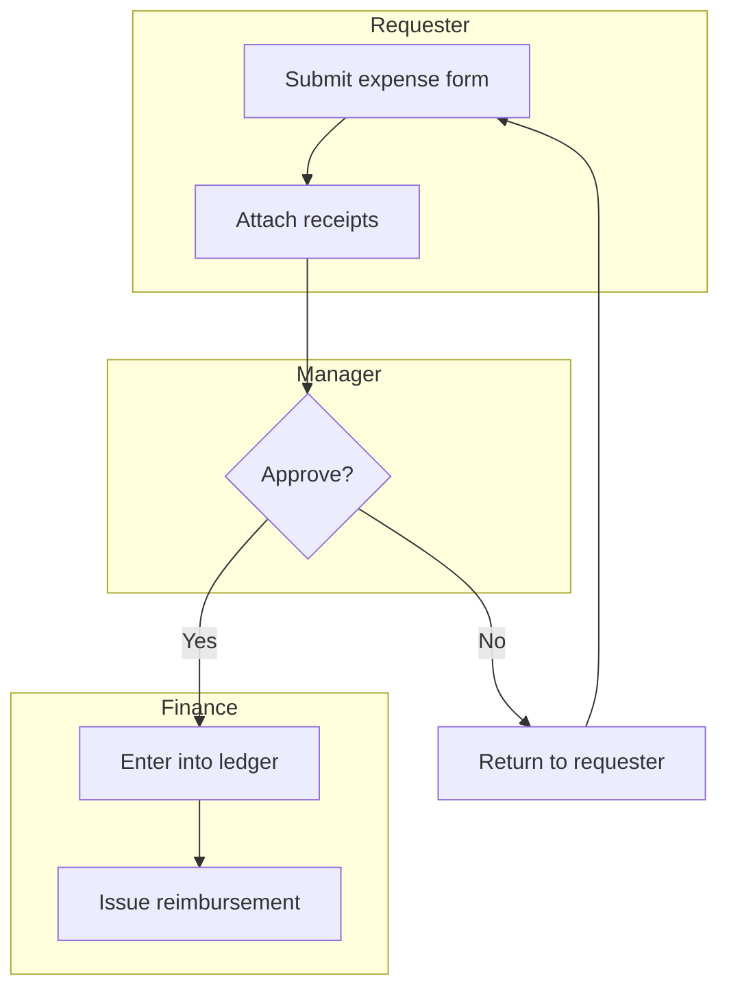

# Journey: map mode

Part of the [`journey`](../SKILL.md) skill. Shared rules in `SKILL.md` still apply.

### Step 1: Identify the process and its boundary

Ask (don't assume): what process, where does it start and end, and who's the primary actor whose journey this traces. A process without a clear start/end trigger ("handling customer requests" is too broad; "a support ticket from submission to resolution" has a boundary) produces an unusable diagram — narrow it before mapping.

### Step 2: Walk the steps interactively

Same discipline as [`interrogate`](../../interrogate/SKILL.md) and `map`'s `objects` mode: one step at a time, confirm before moving on, don't invent steps nobody described. For each step, capture:
- **Actor/lane**: who does this step (a role, not a person's name)
- **Action**: what actually happens, in plain language
- **System(s) touched**: tools, forms, spreadsheets, approvals — whatever's actually used, including informal ones ("a Slack DM to the manager" is a real system if that's how it actually works)
- **Handoff**: what moves to the next actor, and how (an email, a status change, a physical form)

Capture the process **as it actually runs**, including workarounds and informal steps nobody put in a manual — that's usually where `pain-points` mode finds the most. Don't smooth it into how it's supposed to work on paper.

### Step 3: Build the swimlane diagram

Render as Mermaid `flowchart TD`, one subgraph per actor/lane (same subgraph-by-group technique as `map`'s `site` mode):

Keep node labels to the action, not the full narrative (3-6 words, matching `map`'s `flow` mode convention). Write to `docs/JOURNEY_MAP.md` under a `## Current State` heading, with a one-line caption noting the process boundary from Step 1. Use [`templates/journey-map-template.md`](../templates/journey-map-template.md) for the full document shape (all three sections; `pain-points` and `solutions` modes append to the same file).

**Completion criterion:** every step traces to something the actor actually confirmed happens (not assumed or idealized), every actor has their own lane, and the diagram's handoffs match what Step 2 captured.

---
