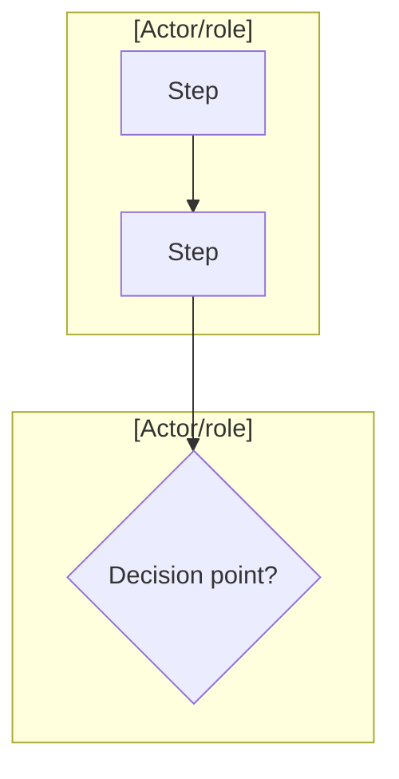

# Journey Map: [process name]

**Boundary:** [where this process starts and ends, and who the primary actor is]

## Current State

[One-line caption: this is the process as it actually runs today, including workarounds, not the idealized version. Use the `map` shape below, or the `blueprint` shape — not both; pick whichever this process actually needed.]

<!-- map mode shape: -->

<!-- blueprint mode shape (customer-facing process; timing and cross-team handoffs matter): -->

| | 1. [Step] | 2. [Step] | 3. [Step] |
|---|---|---|---|
| **Physical Evidence** | [tangible thing, or omit row if none anywhere in the process] | | |
| **Customer Action** | | | |
| *— Line of Interaction —* | | | |
| **Frontstage** | | | |
| *— Line of Visibility —* | | | |
| **Backstage** | | | |
| *— Line of Internal Interaction —* | | | |
| **Support Process** | | | |
| **Duration** | | | |
| **Wait time (until next step)** | | | |

## Pain Points

<!-- One block per scored step, sorted by severity x frequency descending. Skip steps with no real friction — don't pad with placeholder low scores. -->

### [Step name] (Severity [1-3] × Frequency [1-3] = [product])
**Root cause:** [the actual reason, not the symptom]
**Evidence:** [who confirmed this / how]

## Solutions

<!-- One block per pain point actually being tackled this round — not the whole list by default. -->

### [Pain point] → [direction chosen]
**Direction chosen:** [what, and why over the alternatives]
**Considered:** [rejected direction(s) and why]
**Target:** [measurable target, or "not yet knowable — see docs/UNKNOWNS.md"]
