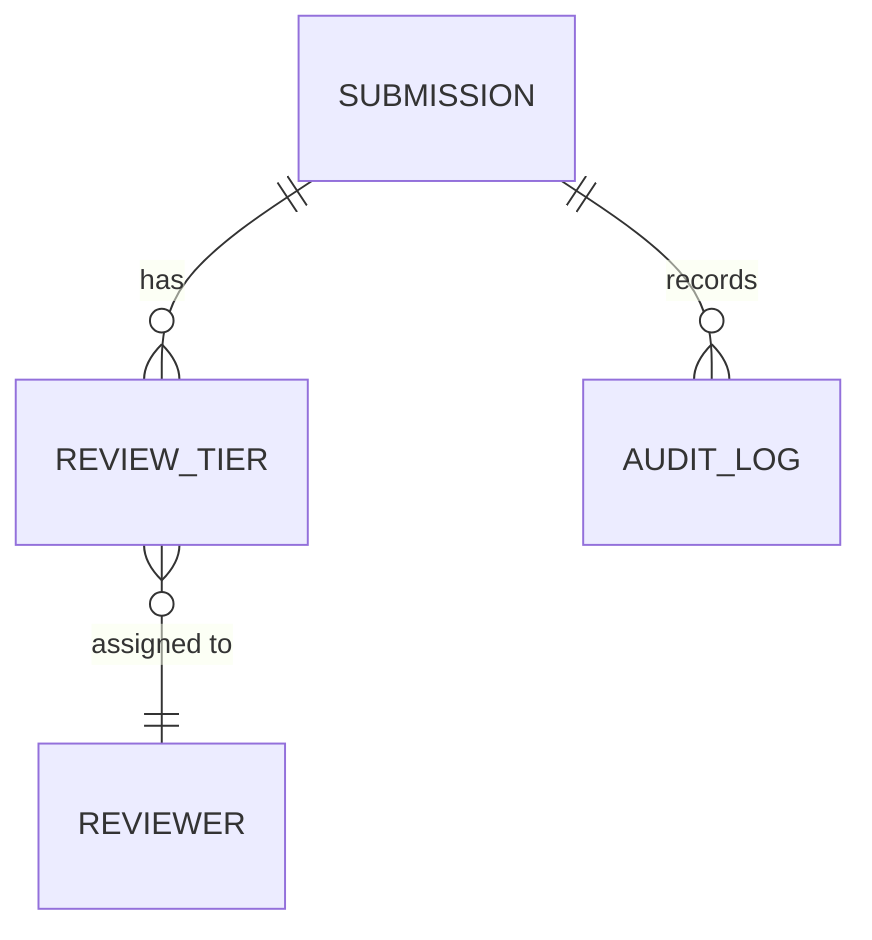
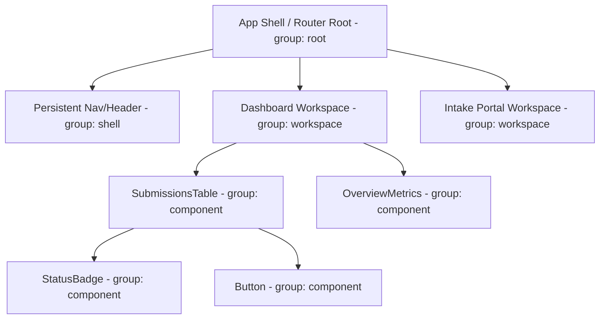
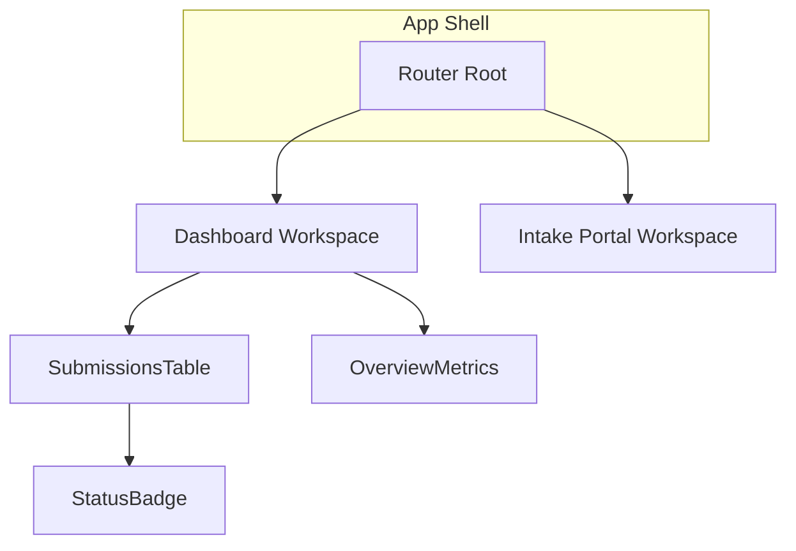

# Map & Domain Modeling

Five modes, one job: turn a prototype's structure — proposed or built — into something you can see instead of just read.

- **`site`** (Decide, before code exists): plans the proposed route/workspace/component architecture as a diagram.
- **`objects`** (Decide): interactive OOUX/ORCA modeling — Objects, Relationships, Calls-to-Action, Attributes — producing `docs/OOUX_OBJECT_MAP.md` and an entity-relationship diagram.
- **`flow`** (Decide onward): a complete, evidence-grounded end-to-end user flow for one goal — every entry point, decision branch, error/empty state, recovery path and exit point, screen by screen, structured to translate directly into wireframes.
- **`audit`** (Decide→Design bridge): reconciles the `objects` model against actual code once it exists. Flags drift; doesn't silently overwrite either side.
- **`document`** (Design, once code exists): regenerates every diagram from the real built app — the in-app interactive architecture map, Mermaid, SVG — and updates the OOUX diagram if the model has drifted since the last `audit`.

Say which mode, or this skill asks. Don't blend them: a route diagram with journey arrows on it, or a flow organized by page instead of by step, both mean the wrong mode was picked. `site` and `document` both produce an architecture diagram, but from opposite ends of the same question — `site` proposes it before anything is built, `document` documents what's actually there.

**Not this skill:**
- Deciding the site's overall navigation, labelling and search systems → [`information-architecture`](../information-architecture/SKILL.md). `flow` mode reads its screen names rather than inventing new ones; it doesn't decide the IA itself.
- Mapping the full emotional experience of a persona through a scenario, or a current-state process → [`journey`](../journey/SKILL.md)'s `experience` or `map`/`blueprint` modes. `flow` mode is the sequence and logic of one task; it isn't about emotion or process-as-it-runs-today.
- Building the actual screens → [`prototype`](../prototype/SKILL.md). A flow is the sequence and logic, not the visual layout.

---

## Output Discipline
- Chat: short, bullets over paragraphs, no recap of what you're about to do — just the result. Expand only if asked.
- Docs this skill writes: plain, scannable prose at the depth its template calls for — cut padding, keep substance.
- Code this skill writes: simplest version that works — stdlib/native first, no speculative abstractions, no unrequested scaffolding.

## Environment
- **Needs:** the conversation for `site`, `objects` and `flow`. `document` and `audit` also need the built code and a file system, and `document` needs Node.js for `vis-network`. A Figma MCP server is needed only for the optional FigJam export.
- **If it isn't available:** No file system here: return the finished document in the conversation and name the path it would be saved to. Never claim a file was written when it was not. Return the Mermaid text in the conversation. If `document` or `audit` has no built code to read, stop and say so. If Figma MCP is not connected, skip the FigJam export.
- **Parallel sub-agents:** use them only where available; otherwise do the same work one item at a time.

## Mode: objects

Maps the object architecture of a prototype using **Object-Oriented UX (OOUX)** and the **ORCA framework** (Objects, Relationships, Calls-to-Action, Attributes). `docs/OOUX_OBJECT_MAP.md` is a **living document**: this mode seeds it before a line of code is written; `audit` mode (below) reconciles it against what actually got built. Don't restart from zero if the doc already exists; extend and correct it.

### Why OOUX for High-Fidelity Prototypes?
1. **Prevents Spaghetti Views**: prototypes get tangled when screens are designed before understanding what objects live on them.
2. **Builds Clean Shared Types**: the OOUX matrix maps directly to `shared/types.ts` and `shared/workflow.ts` in the React prototype.
3. **Aligns Design & Engineering**: creates a common ubiquitous language between designers, product managers, and developers.

Uses the same interactive discipline as [`interrogate`](../interrogate/SKILL.md): **ask one question at a time, offer a recommendation, wait for the answer**, rather than handing over the framework for the user to fill in alone.

### Step 1: Objects (Identify Core Entities)

Scan user stories, persona walkthroughs, and the feature goal. Propose a candidate list of domain nouns (e.g. `Submission`, `ReviewTier`, `Portfolio`) one at a time. For each, ask whether it's a real first-class object or actually an attribute of something else (a common early mistake: turning a status into an object). Confirm before moving on.

### Step 2: Relationships (Map Cardinality)

Walk each confirmed object and ask how it connects to the others already confirmed, one relationship at a time, stated as cardinality (`A Submission has 1..* ReviewTiers`). Don't ask about relationships to objects not yet confirmed in Step 1.

Once relationships are confirmed, render them as a Mermaid `erDiagram`, embedded in `docs/OOUX_OBJECT_MAP.md` alongside the relationship table (see [`templates/ooux-matrix-template.md`](templates/ooux-matrix-template.md) §2 for the exact shape):



Use the real cardinality notation (`||--o{`, `}o--||`, etc.) rather than a plain arrow — the diagram should state the same cardinality the table does, not a looser version of it. This is the chart the ORCA process's Relationships step exists to produce; don't leave it as a table-only artifact.

### Step 3: Calls-to-Action / CTAs (State Transitions & Actions)

For each object, walk its lifecycle interactively. Start by asking whether the lifecycle is one of these shapes. Don't default to linear without checking:
- **Linear**: `Draft` -> `Submit` -> `In Review` -> `Approved` / `Rejected` / `Needs Info`
- **Parallel independent tracks**: multiple independent reviewers (e.g. InfoSec / Legal / Privacy), each with its own `Pending`/`Approved`/`Rejected` state, with overall stage *derived* from the combination. Ask explicitly whether overall state is derived or stored, and document the derivation rule if derived.
- **Terminal states beyond approve/reject**: a `Withdrawn` state the actor can trigger unilaterally, distinct from `Rejected`.
- **Partial resubmission**: after rejection, does the whole object reopen, or only the rejected track/section (with approved parts persisting)?

For each CTA ask who can trigger it and whether it's irreversible (needs confirmation). For a visual state-transition diagram of a specific object's lifecycle (not just the table), use `flow` mode's `stateDiagram-v2` option against this step's output — don't build a second CTA diagram here.

### Step 4: Attributes (Data Elements & Metadata)

For each object, walk through Identity (`id`, `name`, `createdAt`), Status (`workflowState`, `riskScore`), and Content (`description`, `tags`) categories. Ask what's real for this object in each category rather than listing generic examples and assuming they apply.

### Deliverables

Output/update the ORCA model in `docs/OOUX_OBJECT_MAP.md`, including the `erDiagram` from Step 2. Also generate the foundational TypeScript interface draft for `shared/types.ts`.

Use the template at [`templates/ooux-matrix-template.md`](templates/ooux-matrix-template.md).

If a real ORCA question can't be resolved from the codebase or existing docs and needs user/stakeholder input beyond this conversation, append it to `docs/UNKNOWNS.md` rather than guessing (see AGENTS.md §2.6) — a good candidate for the next [`interview`](../interview/SKILL.md) round.

**Completion criterion:** every object, relationship, CTA, and attribute in the final doc was confirmed interactively, nothing invented wholesale from generic examples, and the `erDiagram` reflects the same cardinality as the relationship table, not a stale or looser version of it.

---

## Mode: site

Plans the proposed information architecture as a diagram — routes, workspace shells, and the shared component hierarchy they're expected to need — before any of it is built. This is a planning artifact, not documentation of what's built; see `document` mode for that, once code exists.

### Step 1: Identify the proposed structure

Work from whatever's already decided: the product brief, personas, and (if `objects` mode has already run) the OOUX object map — an object with heavy browse/manage patterns usually implies a dedicated workspace. Ask about anything not yet decided rather than inventing routes: how many top-level workspaces, what persistent shell/nav exists, which components are expected to repeat across workspaces. Component nodes at this stage get a `componentType` (e.g. `Button`) but no `storybookId` — Storybook doesn't exist yet.

### Node taxonomy

Use four node groups, not a strict 5-tier atomic mirror. The graph is about where things are expected to live in the app, not re-documenting atomic tiers (that's what [`storybook`](../storybook/SKILL.md) is for):



- **`root`**: the app shell / router root, exactly one per app.
- **`shell`**: persistent layout regions that wrap every page (nav, header, sidebar).
- **`workspace`**: a routed page/view.
- **`component`**: any reusable component instance, by its proposed `componentType` (its shared base name, e.g. `Button`) so same-type instances highlight together once diagrammed.

### Output: Mermaid + SVG

Render the proposed structure as Mermaid `flowchart TD`, grouped by `group` (root/shell/workspace/component) via Mermaid subgraphs:



Keep node labels to the component/workspace name only — no props; this diagram is for orientation, not implementation detail. Write the result to `docs/ARCHITECTURE_MAP.md`, embedded alongside a short caption noting it's the *proposed* architecture, not yet built.

Render an SVG export from the same Mermaid syntax with the Mermaid CLI, which needs no persistent install:

```bash
npx -y @mermaid-js/mermaid-cli -i docs/ARCHITECTURE_MAP.md -o docs/sitemap.svg
```

(Or pipe just the `mermaid` code block's contents to a `.mmd` file first if the doc has other content mixed in.) The resulting SVG is a single shareable file, viewable with no dependency on this repo or a running dev server.

**Completion criterion:** every proposed workspace/component ties back to a stated product need (a persona task, an OOUX object, a brief requirement) rather than being invented for completeness, and the Mermaid diagram and SVG derive from the same node/edge data.

---

## Mode: flow

Design a complete, evidence-grounded end-to-end user flow — entry points, decisions, error/empty states, recovery paths, exit points — for **one goal**, structured so it translates directly into wireframes. Reads existing IA/journey-map artifacts before inventing structure from scratch.

Estimated time: **20-30 minutes** for one flow.

### Non-negotiable principles (read first)

1. **One flow = one goal.** A flow that tries to cover two unrelated goals is two flows. Split them.
2. **Usability over implementation.** Never bend the flow to fit an internal system's shape or an org boundary — the user's mental model wins, same discipline as `information-architecture`'s own rule.
3. **Never invent screens, business rules or API behaviour.** If a dependency or constraint isn't given, mark it `ASSUMPTION` and name what it's inferred from.
4. **Every flow accounts for failure, not just success.** A flow with no error states, empty states or recovery paths is not finished — it is the happy path pretending to be the whole flow.
5. **Structure for translation, not decoration.** The output must be directly usable by whoever wireframes next — screen name, user goal, primary action, system response, dependencies, every step, no exceptions.
6. **The output is a first draft, not a final user flow.** Always hand back the Human Review checklist.

### When to use this

Use **before**: wireframing (`prototype`) · usability testing · developer handoff · creating user stories for UI. Downstream, the output feeds directly into wireframes — a flow with unresolved edge cases produces a wireframe with the same unresolved edge cases, just harder to see.

### What you'll need

**Required:** problem statement or feature brief + success criteria · primary persona · user goal · an existing `objects`/`site` output or [`information-architecture`](../information-architecture/SKILL.md) output, if available.
**Optional:** current user flow (to run "as is" → "to be") · wireframes · business rules · API documentation · technical constraints · competitor examples.

If any required input is missing, ask **up to five** clarifying questions before designing. Do not silently assume the missing pieces.

### Reading existing context first

A user flow invented from nothing repeats work the project has already done. Before designing, check for and read whichever of these already exist:

| Source | What it gives the flow |
|---|---|
| [`journey`](../journey/SKILL.md)'s `experience` or `map`/`blueprint` output | Stage boundaries, emotional low points, pain points already evidenced per stage |
| [`information-architecture`](../information-architecture/SKILL.md) output | The page/nav structure the flow must move through — screen names should match its labels, not invent new ones |
| [`problem-statement`](../problem-statement/SKILL.md) output | The specific goal and acceptance criteria the flow must satisfy |
| [`competitor-analysis`](../competitor-analysis/SKILL.md) or [`ux-benchmark`](../ux-benchmark/SKILL.md) output | Real precedent for how this task is solved elsewhere — a pattern to adopt/adapt/avoid, not a pain claim |
| An existing user flow | The "as is" baseline, if redesigning rather than designing fresh |

If a required source doesn't exist yet in the project, say so and ask whether to proceed on stated assumptions or wait for it — do not quietly fabricate the missing IA or persona.

### The workflow

```
Review flow → Define screens → Design flow → Identify edge cases → Optimise experience → Review & Export
```

**Step 0 — Clarify** (only if required inputs are missing): product, feature, business objective, persona, primary user goal, success criteria, and what context already exists. Then stop and wait.

**Step 1 — Review.** If an "as is" flow exists, walk it first — note where it already breaks before redesigning anything.

**Step 2 — Define screens.** List every screen/modal/decision point the goal requires, grounded in the IA if one exists. Don't invent a screen name the IA doesn't already use.

**Step 3 — Design the flow.** Sequence entry point → actions → decisions → success path, screen by screen. For **every** screen/step capture: screen name (matching the IA's own label where one exists), user goal, primary action, system response, dependencies.

**Step 4 — Identify edge cases.** For every decision point and every system response, ask "what else can happen here?" — error states, empty states, timeouts, permission failures, offline, back-navigation. Give each a recovery path or an explicit exit, never a dead end.

**Step 5 — Optimise.** Pass over the whole flow looking to remove unnecessary steps, reduce cognitive load, improve clarity, prevent user errors, reduce abandonment. Note what changed and why.

**Step 6 — Review & export.** Produce the deliverables below, attach the Human Review checklist, export as Markdown, an HTML diagram, or a table.

**Completion criterion:** every screen has a filled schema, every decision point has both branches drawn, and every terminal state resolves to success, an explicit error, or a stated exit.

### Required flow components

Entry points (every way in, not just the primary one) · user actions · system responses · decision points (both branches drawn) · success paths · error states (with recovery) · empty states · recovery paths · exit points.

### Deliverables

1. **Executive Summary** — goal, entry points, headline optimisation, top risk.
2. **User Flow** — the complete end-to-end flow, screen by screen.
3. **Screen Inventory** — every screen, modal and decision point required.
4. **Edge Cases & Error States** — every alternative path, failure scenario, recovery route.
5. **UX Rationale** — reasoning behind key decisions and simplifications.
6. **Optimisation Opportunities** — what was removed/simplified and why.
7. **Validation Checklist** — usability risks, assumptions, what still needs validating.

### Output format (text version)

```
EXECUTIVE SUMMARY
[Persona] · [Goal] · [Entry points] — headline simplification, top risk.

SCREEN INVENTORY
1. [Screen] — [purpose]

USER FLOW
[Entry] → [Screen 1: action → response] → [Decision] ─Yes→ [Screen 2] ─No→ [Error/Recovery] → … → [Exit/Success]

EDGE CASES & ERROR STATES
| Trigger | State shown | Recovery path |
|---|---|---|

VALIDATION CHECKLIST
- [ ] [assumption or path to verify with real users]
```

Adapt to the medium — diagram, table, written narrative — based on what the user needs. For a state-machine-shaped flow, `stateDiagram-v2` (see `objects` mode Step 3) may fit better than the flowchart above.

### Human review required

Confirm every source in the table above was actually consulted, not assumed. Verify the flow supports the primary goal. Ensure edge cases and error states have been considered. Remove unnecessary steps. Validate with stakeholders and representative users where possible.

**Treat the output as a first draft, not a final user flow.**

---

## Mode: audit

Reconciles `objects` mode's model against what actually got built, once a prototype exists (with or without a prior `docs/OOUX_OBJECT_MAP.md`). Scans the actual codebase (`shared/types.ts`, component props, route structure) and walks through the same four ORCA steps, but each step compares what's found in code against what the doc says. Flag drift explicitly rather than silently overwriting either side.

### Step 1: Objects

Scan `shared/types.ts` and component names for what's actually modeled as an object today. For each real object found, check whether it's already in `docs/OOUX_OBJECT_MAP.md`. If not, propose adding it; if the doc lists an object that doesn't exist in code, ask whether it was descoped or just not built yet.

### Step 2: Relationships

Check the actual foreign-key-like references in `shared/types.ts` (a field like `portfolioId` on `Holding`) against the documented relationship. Flag any relationship in code with no doc entry, and any documented relationship with nothing in code backing it.

### Step 3: Calls-to-Action / CTAs

Check `shared/workflow.ts` or equivalent state-machine code against the documented lifecycle shape. A lifecycle that's actually parallel-track in code but documented as linear (or vice versa) is exactly the kind of drift this mode exists to catch.

### Step 4: Attributes

Diff the object's actual TypeScript interface fields against the documented attribute list.

### Deliverables

Report drift as a findings list (object/relationship/CTA/attribute, documented vs. actual, recommended resolution) rather than silently editing either side. Once resolved with the user, update `docs/OOUX_OBJECT_MAP.md` and its `erDiagram` (see `objects` mode Step 2) to match the reconciled state.

**Completion criterion:** every object, relationship, CTA, and attribute was reconciled against real code, findings were reported rather than silently resolved, and (once the user has weighed in) the doc and its `erDiagram` match the reconciled state, not the pre-audit one.

---

## Mode: document

Once real code exists, regenerates every diagram from the actual built app so they don't go stale as the prototype evolves. Where `site` mode plans and `objects` mode models before anything is built, `document` mode is the after-the-fact refresh: it doesn't invent new structure, it reflects what's actually there.

### Step 1: Refresh the site diagram (Interactive, Mermaid, SVG)

Produces three synced outputs from the actual route tree and component usage — don't hand-edit any of them independently; regenerate all three together whenever the route/component structure changes.

**Interactive (Vis.js modal):**
1. Install the Vis.js network packages:
   ```bash
   npm install vis-network vis-data
   ```
   If the prototype can't add a dependency, load Vis.js as a CDN UMD script (`window.vis`) with a readiness poll instead — only as a fallback when npm install is genuinely blocked, since the typed import is easier to maintain.
2. Embed [`templates/ArchitectureMapModalComponent.tsx`](templates/ArchitectureMapModalComponent.tsx) in your prototype layout. It accepts `nodes`/`edges` as props; build them from the actual route tree and component usage, don't hardcode the example data.
3. Wire the trigger into the user menu's Prototype Tools section as "Architecture Map" (see [`prototype`](../prototype/SKILL.md)).
4. Set `storybookBasePath` to wherever the embedded static Storybook is served from (default `/storybook/index.html`) so deep links resolve. Give each `component` node a real `storybookId` (matching its Storybook story path, e.g. `organisms-submissionstable--default`) now that Storybook actually exists — `site` mode couldn't do this before code existed.

**Completion criterion:** clicking any `component` node with a `componentType` dims all unrelated nodes and keeps every same-type instance highlighted; clicking a node with a `storybookId` shows a working "View in Storybook" link in the side panel.

**Mermaid (portable diagram):** convert the same `nodes`/`edges` data into Mermaid `flowchart TD` syntax, grouped by `group` via subgraphs. Write to `docs/ARCHITECTURE_MAP.md`, replacing `site` mode's proposed-architecture version with the as-built one.

**SVG (standalone export):** reuse the Mermaid syntax rather than building a second graph representation:
```bash
npx -y @mermaid-js/mermaid-cli -i docs/ARCHITECTURE_MAP.md -o docs/sitemap.svg
```

### Step 2: Reconcile the object model, if needed

Check whether `docs/OOUX_OBJECT_MAP.md` has drifted since the last `audit` pass (or since `objects` mode last ran, if `audit` has never run). If it has, run `audit` mode's checks now, resolve findings with the user the same way `audit` mode directs (report, don't silently overwrite), then regenerate the `erDiagram` from the reconciled doc. If nothing has drifted, skip this step and say so rather than running a no-op reconciliation.

**Completion criterion:** all three site outputs derive from the same current node/edge data pulled from the actual codebase, and `docs/OOUX_OBJECT_MAP.md`'s `erDiagram` matches the current, reconciled object model rather than the last-stated plan.

---

## Optional: export to FigJam

Any diagram-producing mode can push its diagram into FigJam once the Figma MCP server is connected (`mcp__claude_ai_Figma__*` tools, its diagram-generation capability). Never assume it's present; check first, and if not connected, finish at the Mermaid/SVG output and say so rather than guessing at Figma's structure.

If connected: offer to generate the diagram in FigJam from the same node/edge data (`site`/`document` modes), step sequence (`flow` mode), or entity/relationship data (`objects` mode) already built for the Mermaid output, not a re-derived version. Confirm the target Figma file or board with the user before creating anything — the same discipline [`figma`](../figma/SKILL.md) and [`requirements`](../requirements/SKILL.md) use before writing to an external system — and report back what was created (file/board link).
