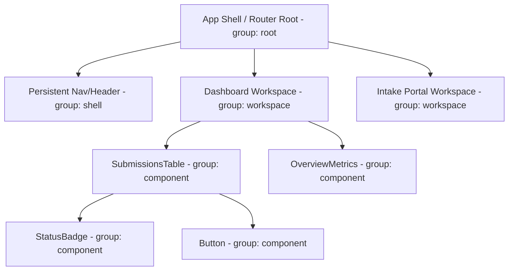
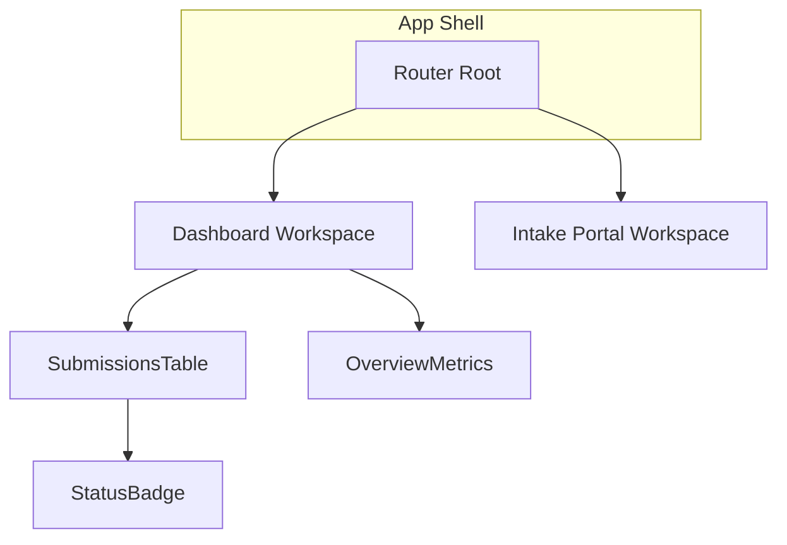
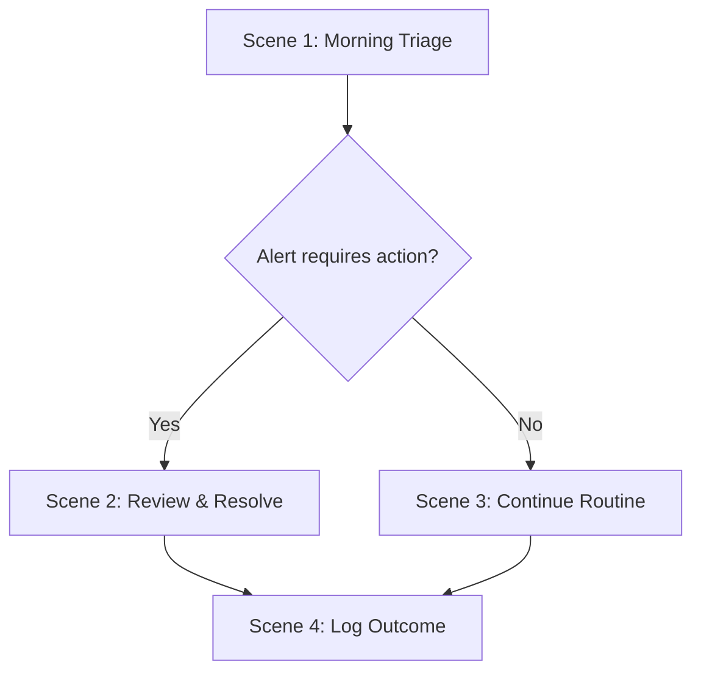

# Map

One skill, two modes: both turn structure into a diagram, but the structure differs. `site` maps where things live in the app; `flow` maps the sequence something goes through. Say which mode, or this skill asks.

- **`site`**: routes, workspace shells, and shared component hierarchy. Produces three synced outputs (an in-app interactive modal, a Mermaid doc, an SVG export).
- **`flow`**: a persona's journey or a branching workflow's decision points. Produces a single Mermaid diagram embedded in the doc it illustrates.

If asked for "a sitemap" or "an architecture map," use `site`; for a journey, workflow, or decision tree, use `flow`. Don't blend them: a route diagram with journey arrows on it, or a journey diagram organized by page instead of by step, both mean the wrong mode was picked.

---

## Mode: site

### Node taxonomy

Use four node groups, not a strict 5-tier atomic mirror. The graph is about where things live in the app, not re-documenting atomic tiers (that's what [`storybook`](../storybook/SKILL.md) is for):



- **`root`**: the app shell / router root, exactly one per app.
- **`shell`**: persistent layout regions that wrap every page (nav, header, sidebar).
- **`workspace`**: a routed page/view.
- **`component`**: any reusable component instance. Give it a `componentType` (its shared base name, e.g. `Button`) so same-type instances highlight together, and a `storybookId` (matching its Storybook story path, e.g. `organisms-submissionstable--default`) to enable the deep link.

### Output 1: Interactive (Vis.js modal)

1. Install the Vis.js network packages:
   ```bash
   npm install vis-network vis-data
   ```
   If the prototype can't add a dependency, load Vis.js as a CDN UMD script (`window.vis`) with a readiness poll instead — only as a fallback when npm install is genuinely blocked, since the typed import is easier to maintain.
2. Embed [`templates/ArchitectureMapModalComponent.tsx`](templates/ArchitectureMapModalComponent.tsx) in your prototype layout. It accepts `nodes`/`edges` as props; build them from the actual route tree and component usage, don't hardcode the example data.
3. Wire the trigger into the user menu's Prototype Tools section as "Architecture Map" (see [`scaffold`](../scaffold/SKILL.md)).
4. Set `storybookBasePath` to wherever the embedded static Storybook is served from (default `/storybook/index.html`) so deep links resolve.

**Completion criterion:** clicking any `component` node with a `componentType` dims all unrelated nodes and keeps every same-type instance highlighted; clicking a node with a `storybookId` shows a working "View in Storybook" link in the side panel.

### Output 2: Mermaid (portable diagram)

Convert the same `nodes`/`edges` data into Mermaid `flowchart TD` syntax: one line per node, one arrow per edge, grouped by `group` (root/shell/workspace/component) via Mermaid subgraphs so the hierarchy reads clearly without Vis.js's physics layout:



Keep node labels to the component/workspace name only — no props, no `storybookId`; this diagram is for orientation, not implementation detail. Write the result to `docs/ARCHITECTURE_MAP.md`, embedded alongside a short caption of what the map shows.

### Output 3: SVG (standalone export)

Reuse the Mermaid syntax from Output 2 rather than building a second graph representation. Render it to SVG with the Mermaid CLI, which needs no persistent install:

```bash
npx -y @mermaid-js/mermaid-cli -i docs/ARCHITECTURE_MAP.md -o docs/sitemap.svg
```

(Or pipe just the `mermaid` code block's contents to a `.mmd` file first if the doc has other content mixed in.) The resulting SVG is a single shareable file, viewable with no dependency on this repo, this prototype, or a running dev server.

**Completion criterion (Outputs 2 & 3):** the Mermaid diagram and the SVG both derive from the same node/edge data as Output 1. Regenerate all three together when the route/component structure changes, don't let them drift independently.

---

## Mode: flow

### Step 1: Identify the source

- **A single persona's journey**: source from `docs/PERSONA_WALKTHROUGH.md`'s scenes. Each scene becomes a node, phase groupings become subgraphs.
- **A branching workflow with multiple scenarios/paths** (different outcomes depending on a decision point, gates, or conditional steps): source from [`concepting`](../concepting/SKILL.md)'s CTA/state-transition model, or from the user directly if not yet documented there.

Don't invent steps not present in the source. If incomplete, note the gap (append to `docs/UNKNOWNS.md` if it's a real open question) rather than filling it in.

### Step 2: Pick the right Mermaid diagram type

- **`flowchart TD`**: a linear or lightly-branching journey (most persona walkthroughs).
- **`flowchart TD` with decision nodes (`{...}`)**: a workflow with real branch points, different paths depending on a condition (a review gate, an approval outcome).
- **`stateDiagram-v2`**: when the source is fundamentally a state machine (matches `concepting`'s CTA modeling directly, especially useful for parallel independent tracks; see `concepting`'s guidance on that pattern).

### Step 3: Build the diagram



Keep node labels short (3-6 words) — the diagram is a map, not a transcript; the full narrative stays in the prose doc it's embedded alongside, not crammed into node text.

### Step 4: Embed and cross-link

Embed the finished diagram directly in the relevant doc (a mermaid code fence renders natively). Cross-link both directions: the diagram sits next to the prose scene/workflow it visualizes, and if [`guide`](../guide/SKILL.md) documents this workflow for end users, embed the same diagram there too rather than redrawing it.

**Completion criterion:** every node traces to a real scene or state from the source doc, the diagram type matches the source's actual shape (linear vs. branching vs. state machine), and it's embedded in the doc it illustrates, not left as an orphaned file.

---

## Optional: export to FigJam

Either mode can push its diagram into FigJam once the Figma MCP server is connected (`mcp__claude_ai_Figma__*` tools, its diagram-generation capability). Never assume it's present; check first, and if not connected, finish at the Mermaid/SVG output and say so rather than guessing at Figma's structure.

If connected: offer to generate the diagram in FigJam from the same node/edge data (`site` mode) or step sequence (`flow` mode) already built for the Mermaid output, not a re-derived version. Confirm the target Figma file or board with the user before creating anything — the same discipline [`figma`](../figma/SKILL.md) and [`requirements`](../requirements/SKILL.md) use before writing to an external system — and report back what was created (file/board link).
