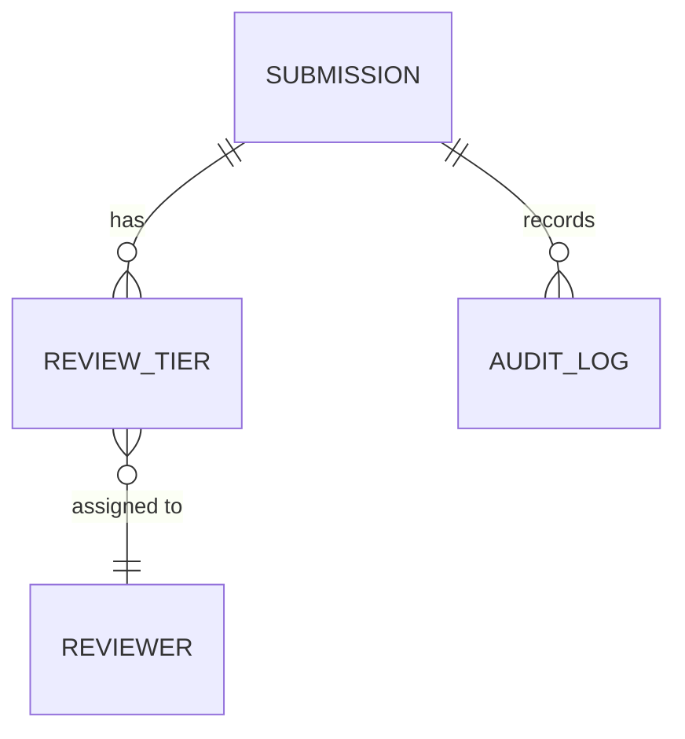

# Map: objects mode

Part of the [`map`](../SKILL.md) skill. Shared rules in `SKILL.md` still apply.

Maps the object architecture of a prototype using **Object-Oriented UX (OOUX)** and the **ORCA framework** (Objects, Relationships, Calls-to-Action, Attributes). `docs/OOUX_OBJECT_MAP.md` is a **living document**: this mode seeds it before a line of code is written; `audit` mode (see `references/audit.md`) reconciles it against what actually got built. Don't restart from zero if the doc already exists; extend and correct it.

### Why OOUX for High-Fidelity Prototypes?
1. **Prevents Spaghetti Views**: prototypes get tangled when screens are designed before understanding what objects live on them.
2. **Builds Clean Shared Types**: the OOUX matrix maps directly to `shared/types.ts` and `shared/workflow.ts` in the React prototype.
3. **Aligns Design & Engineering**: creates a common ubiquitous language between designers, product managers, and developers.

Uses the same interactive discipline as [`interrogate`](../../interrogate/SKILL.md): **ask one question at a time, offer a recommendation, wait for the answer**, rather than handing over the framework for the user to fill in alone.

### Step 1: Objects (Identify Core Entities)

Scan user stories, persona walkthroughs, and the feature goal. Propose a candidate list of domain nouns (e.g. `Submission`, `ReviewTier`, `Portfolio`) one at a time. For each, ask whether it's a real first-class object or actually an attribute of something else (a common early mistake: turning a status into an object). Confirm before moving on.

### Step 2: Relationships (Map Cardinality)

Walk each confirmed object and ask how it connects to the others already confirmed, one relationship at a time, stated as cardinality (`A Submission has 1..* ReviewTiers`). Don't ask about relationships to objects not yet confirmed in Step 1.

Once relationships are confirmed, render them as a Mermaid `erDiagram`, embedded in `docs/OOUX_OBJECT_MAP.md` alongside the relationship table (see [`templates/ooux-matrix-template.md`](../templates/ooux-matrix-template.md) §2 for the exact shape):

Use the real cardinality notation (`||--o{`, `}o--||`, etc.) rather than a plain arrow — the diagram should state the same cardinality the table does, not a looser version of it. This is the chart the ORCA process's Relationships step exists to produce; don't leave it as a table-only artifact.

### Step 3: Calls-to-Action / CTAs (State Transitions & Actions)

For each object, walk its lifecycle interactively. Start by asking whether the lifecycle is one of these shapes. Don't default to linear without checking:
- **Linear**: `Draft` -> `Submit` -> `In Review` -> `Approved` / `Rejected` / `Needs Info`
- **Parallel independent tracks**: multiple independent reviewers (e.g. InfoSec / Legal / Privacy), each with its own `Pending`/`Approved`/`Rejected` state, with overall stage *derived* from the combination. Ask explicitly whether overall state is derived or stored, and document the derivation rule if derived.
- **Terminal states beyond approve/reject**: a `Withdrawn` state the actor can trigger unilaterally, distinct from `Rejected`.
- **Partial resubmission**: after rejection, does the whole object reopen, or only the rejected track/section (with approved parts persisting)?

For each CTA ask who can trigger it and whether it's irreversible (needs confirmation). For a visual state-transition diagram of a specific object's lifecycle (not just the table), use `flow` mode's `stateDiagram-v2` option against this step's output — don't build a second CTA diagram here.

### Step 4: Attributes (Data Elements & Metadata)

For each object, walk through Identity (`id`, `name`, `createdAt`), Status (`workflowState`, `riskScore`), and Content (`description`, `tags`) categories. Ask what's real for this object in each category rather than listing generic examples and assuming they apply.

### Deliverables

Output/update the ORCA model in `docs/OOUX_OBJECT_MAP.md`, including the `erDiagram` from Step 2. Also generate the foundational TypeScript interface draft for `shared/types.ts`.

Use the template at [`templates/ooux-matrix-template.md`](../templates/ooux-matrix-template.md).

If a real ORCA question can't be resolved from the codebase or existing docs and needs user/stakeholder input beyond this conversation, append it to `docs/UNKNOWNS.md` rather than guessing (see AGENTS.md §2.6) — a good candidate for the next [`interview`](../../interview/SKILL.md) round.

**Completion criterion:** every object, relationship, CTA, and attribute in the final doc was confirmed interactively, nothing invented wholesale from generic examples, and the `erDiagram` reflects the same cardinality as the relationship table, not a stale or looser version of it.

---
