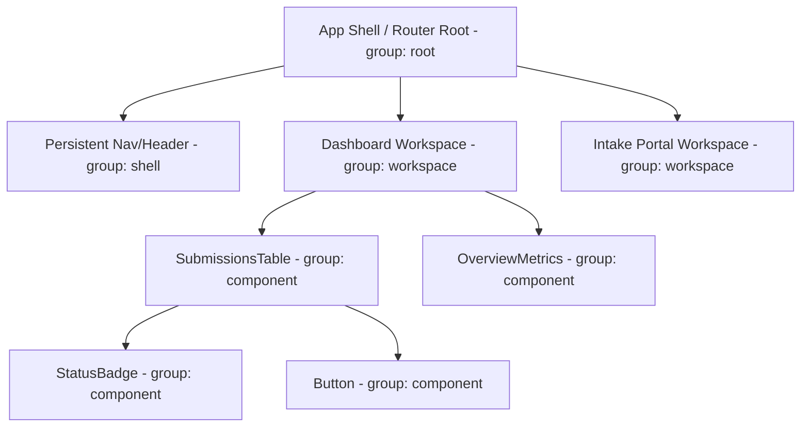
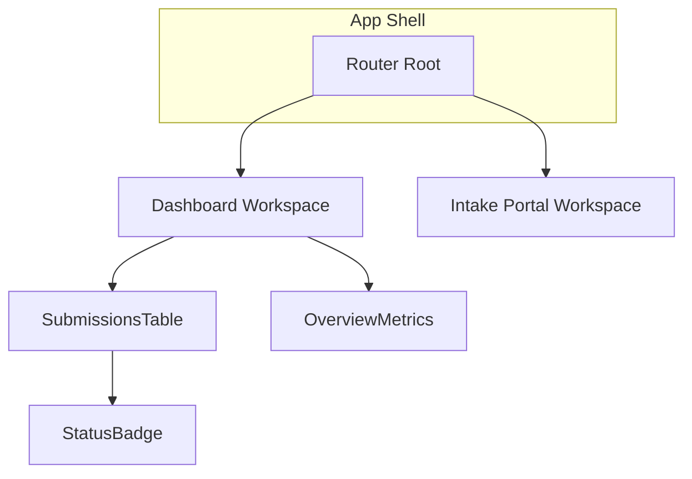

# Map: site mode

Part of the [`map`](../SKILL.md) skill. Shared rules in `SKILL.md` still apply.

Plans the proposed information architecture as a diagram — routes, workspace shells, and the shared component hierarchy they're expected to need — before any of it is built. This is a planning artifact, not documentation of what's built; see `document` mode for that, once code exists.

### Step 1: Identify the proposed structure

Work from whatever's already decided: the product brief, personas, and (if `ia` mode has already run) its sitemap, and (if `objects` mode has already run) the OOUX object map — an object with heavy browse/manage patterns usually implies a dedicated workspace. Ask about anything not yet decided rather than inventing routes: how many top-level workspaces, what persistent shell/nav exists, which components are expected to repeat across workspaces. Component nodes at this stage get a `componentType` (e.g. `Button`) but no `storybookId` — Storybook doesn't exist yet.

### Node taxonomy

Use four node groups, not a strict 5-tier atomic mirror. The graph is about where things are expected to live in the app, not re-documenting atomic tiers (that's what [`storybook`](../../storybook/SKILL.md) is for):



- **`root`**: the app shell / router root, exactly one per app.
- **`shell`**: persistent layout regions that wrap every page (nav, header, sidebar).
- **`workspace`**: a routed page/view.
- **`component`**: any reusable component instance, by its proposed `componentType` (its shared base name, e.g. `Button`) so same-type instances highlight together once diagrammed.

### Output: Mermaid + SVG

Render the proposed structure as Mermaid `flowchart TD`, grouped by `group` (root/shell/workspace/component) via Mermaid subgraphs:



Keep node labels to the component/workspace name only — no props; this diagram is for orientation, not implementation detail. Write the result to `docs/ARCHITECTURE_MAP.md`, embedded alongside a short caption noting it's the *proposed* architecture, not yet built.

Render an SVG export from the same Mermaid syntax with the Mermaid CLI, which needs no persistent install:

```bash
npx -y @mermaid-js/mermaid-cli -i docs/ARCHITECTURE_MAP.md -o docs/sitemap.svg
```

(Or pipe just the `mermaid` code block's contents to a `.mmd` file first if the doc has other content mixed in.) The resulting SVG is a single shareable file, viewable with no dependency on this repo or a running dev server.

**Completion criterion:** every proposed workspace/component ties back to a stated product need (a persona task, an OOUX object, a brief requirement) rather than being invented for completeness, and the Mermaid diagram and SVG derive from the same node/edge data.

---
