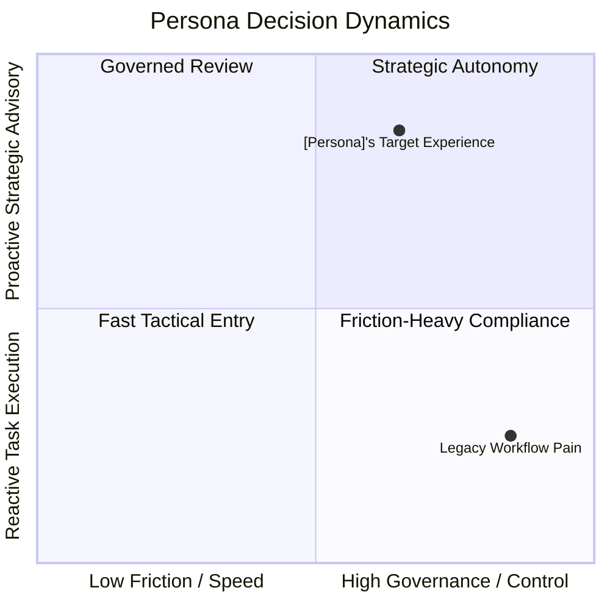

# Day-in-the-Life Walkthrough: [Persona Name / Role]

**Subject:** [Persona Name], from the existing `card`-mode persona set. Do not redefine
this profile here — pull it from the card. The fields below are the card's fields,
restated only as much as needed to anchor the scenes that follow.

## 1. Persona Profile (from `card`, not re-authored)

- **Target User**: [name, age, occupation — from the card]
- **Tag line**: [from the card]
- **Goals**: [from the card]
- **Frustrations**: [from the card]
- **Context of use**: [from the card]

If any of these need to change while writing the walkthrough, that's a signal the card
itself is stale — update the card via `card` mode, don't let this document silently
diverge from it.

---

## 2. Core Archetype & Decision Drivers (optional)

Include only where the persona's decisions genuinely trade off two real axes (e.g. speed
vs. governance). Skip this section for personas whose day doesn't hinge on such a
tradeoff — an empty quadrant chart is worse than no chart.

---

## 3. Chronological Day-in-the-Life Walkthrough

### Scene 1: [Title] ([time])

<!-- If no screenshot exists yet, delete the image line and write the narrative first. -->

[1-3 sentences: what's happening, why now, what triggered it. Call out a friction point
or autonomy opportunity inline here if this scene hinges on one — don't force an empty
column for scenes that don't.]

**What's on screen:**
- [notable UI element / data point / affordance visible in this scene]

### Scene 2: [Title] ([time])

[narrative]

**What's on screen:**
-

<!-- Add scenes as needed. Group into realistic phases across the day rather than a fixed count. -->
