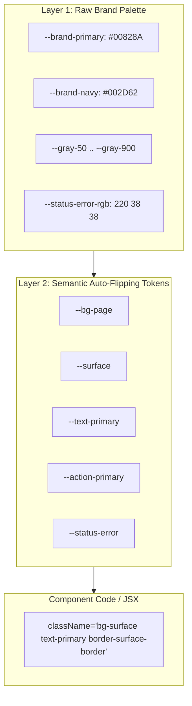

# UX Style Documentation & Two-Layer Design Tokens

This skill defines and documents a production-ready **Two-Layer CSS Custom Property Token Architecture** and creates a single-source-of-truth `DESIGN.md` file for any web prototype.

Two modes populate Layer 1, same Layer 2 shape either way:
- **default** — placeholder palette, for a new prototype with no real brand yet.
- **forge** — cast a real brand's colors/fonts/spacing into the architecture, from a live site, brand guide, or verified hex values. Use for a new prototype with a real brand ready, or to rebrand an existing one.

Before picking a mode, ask whether a Figma library already exists for this product. If the user gives a link, that's forge mode sourced from Figma: hand off to [`figma`](../figma/SKILL.md)'s `sync` mode, Import direction, to pull the library's Variables and map them onto the semantic roles below, rather than sourcing from a live site/brand guide/typed hex values. Only fall back to a live site, brand guide, or default placeholder palette if there's no Figma library yet.

---

## Output Discipline
- Keep chat replies short and bullet-first, docs plain and scannable, and code the simplest version that works (stdlib and native first).

## The Two-Layer Token Architecture



### Layer 1: Raw Brand Palette
- Defined once at `:root`: raw hex codes and RGB triplets for the brand's color palette, gray scales, font families, and status hues.
- **Rule**: Component JSX *never* references Layer 1 classes directly.

### Layer 2: Semantic Roles (Auto-Flipping)
- Defined in `:root` (Light theme) and re-bound under `.dark` (Dark theme).
- Token names represent UI roles (`bg-page`, `surface`, `text-primary`, `surface-border`, `action-primary`). See [`references/token-spec.md`](references/token-spec.md) for the default value matrix and [`references/semantic-role-mold.md`](references/semantic-role-mold.md) for the full, fixed role list — every prototype in this suite binds these exact names; `audit` and `storybook` assume this shape.
- **The Golden Rule**: One semantic class automatically renders correctly in both light and dark modes without manual `dark:` overrides!
- **Dark mode scope**: rebind under a global `.dark` class on `<html>`/`<body>` by default. If a prototype needs a component-scoped theme (e.g. a dashboard region that stays dark regardless of app theme), scope the rebind to that component's root class instead (`.my-widget.theme-dark`) rather than the global `.dark`, but keep it the exception, not the default.
- **No exceptions for status colors**: every status role (`status-success`, `status-error`, etc.) must be a real semantic token, never a raw Tailwind palette class (`bg-red-50`, `text-amber-800`) with a hand-written `dark:` pair. That reintroduces exactly the maintenance burden Layer 2 exists to remove.

---

## Process

### Step 1: Establish Layer 1 & Layer 2 in `src/index.css`

Two paths in, same destination — a complete two-layer token block in `index.css`. Pick based on whether a real brand exists yet.

#### Default mode — placeholder palette
Copy [`templates/index.css`](templates/index.css) to `src/index.css`. It holds the complete token set: Layer 1 raw palette, Layer 2 roles for light and `.dark`, the Tailwind v4 mapping, the elevation utilities, and a `prefers-reduced-motion` rule. Every text and UI pair in it already passes WCAG AA (checked with `tools/check-token-contrast`), so a project that starts here starts accessible.

Check the claim again after any edit to the file:

```bash
node ../../tools/check-token-contrast/check-token-contrast.mjs src/index.css
```

For a bolder, marketing-forward brand, use a numbered elevation ladder instead of the two shadow tiers (`--shadow-level1..5`, same for `--radius-level1..5`). Register each step as a `@utility` (see [`references/tailwind-v4.md`](references/tailwind-v4.md)). Pick one convention per prototype; do not mix both.

#### Forge mode — cast a real brand
`references/semantic-role-mold.md` is the fixed list of semantic roles every prototype in this suite binds. Forge mode casts a specific brand's raw values into that exact mold: Layer 1 (the brand's own palette) is new every time, Layer 2 (the role names) never changes shape. Component code never sees the difference — it only ever references the semantic roles.

1. **Find the brand's real sources.**
   - Ask what's available: a live site to pull CSS from, a brand guide (PDF/Figma/doc), hex codes/font names typed directly, or a direction already chosen through [`restyle`](../restyle/SKILL.md) (that skill hands off its winning candidate's full token set here as a confirmed source, not something to re-derive).
   - **Verified beats guessed.** With no brand guide to work from — hex codes typed directly, or values that need confirming against something real — prefer grepping a live site's actual CSS for real class-based color/spacing values over inventing or half-remembering one. This is about filling gaps, not about which source outranks the other when both exist (see below).
   - **If a brand guide exists and conflicts with the live site** (a brand guide states one hex, the live site renders another), the brand guide wins — it's the documented source of intended brand direction, and a live site is just as likely to be out of date with it (not fully migrated, mid-rebrand) as the guide is to be stale. Don't silently pick the live value instead; a site that hasn't caught up to its own brand guide isn't a reason to encode its drift as the spec. Still confirm with the user rather than assume the conflict is exactly this and nothing else — a real brand refresh in progress is the one case where the live site *is* right and the guide is what's stale, and only a human knows which situation it actually is. **Autonomous mode** (suite `AGENTS.md` §2.9, tier 3): never guess between them regardless. Use the brand guide's stated value as the provisional value, label it in `DESIGN.md` as "provisional — conflicts with the live site, needs confirmation," and log the conflict to `docs/UNKNOWNS.md` flagged blocking.
   - If tints/shades (lighter/light/dark/foundational) aren't supplied for a color and can't be found in a live source, either ask for them or derive them via consistent HSL-lightness steps, and if derived, label them "computed, not brand-verified" in `DESIGN.md`. Don't present a guess as a fact. **Autonomous mode:** default to deriving via HSL-lightness steps (already the documented fallback) and label accordingly — this is tier 1, the skill already names the safe default.
   - **Completion criterion:** every hex value about to be written into `index.css` traces to either a verified source or an explicitly labeled computation. None are silently invented.

2. **Cast Layer 1, the raw palette.**
   - Build a color matrix with at minimum: a primary hue family (with tiers), a secondary/neutral corporate color, a gray scale, and four status colors (error/success/warning/info). Add `pending`/`neutral` status variants too if the app has workflow-state badges beyond those four. Also capture the brand's font stack and, if a live site is available, its real spacing rhythm (grep actual padding/margin/gap values; don't assume a generic 8px scale applies without checking).
   - **Completion criterion:** every role the semantic mold requires a raw value for (primary + tiers, secondary, gray scale, status set) has a same-shaped brand value. No role silently dropped.

3. **Rebind Layer 2, the roles.**
   - Open [`references/semantic-role-mold.md`](references/semantic-role-mold.md) and rebind every semantic variable listed there to the new Layer 1 values, using the *same role each one already plays*, in `index.css`'s `:root` (light) and `.dark` (dark) blocks. Do not rename, add, or drop a role — that shape is what `audit` and `storybook` assume across every prototype in this suite:
     - `bg-page`, `surface`, `surface-hover`, `surface-border` → the new gray scale
     - `text-primary`, `text-secondary`, `text-muted`, `text-brand` → the new grays + secondary accent
     - `action-primary` (+`-hover`/`-active`), `action-secondary`, `action-accent` (+`-foreground`), `focus-ring` → the new primary/secondary/accent hues
     - `border-input`, `border-emphasis` → the new gray scale
     - `status-error`/`-success`/`-warning`/`-info` (+`-pending`/`-neutral` if added) and their `-text` pairs, **as RGB triplets, not hex**; the `@theme inline` mapping turns each triplet into a color, so `bg-status-success/15` works
   - **Completion criterion:** `index.css` has one CSS variable for every role in `semantic-role-mold.md`, in both `:root` and `.dark`, new brand values, same names. A renamed or missing role breaks every component that references it.

Whichever mode populated `index.css`, continue to Step 2.

### Step 2: Mirror tokens in Tailwind (`@theme inline` in `index.css`)
Map each semantic role to a Tailwind v4 theme key so developers write `bg-surface`, `text-primary`, `bg-status-success/15`. The default template already does this. In forge mode, keep the block and change only the Layer 1 and Layer 2 values. There is no `tailwind.config.js` in a v4 prototype. See [`references/tailwind-v4.md`](references/tailwind-v4.md) for the role-to-utility table and for moving a v3 prototype.

### Step 3: Generate `DESIGN.md`
Generate `DESIGN.md` per the exact spec in [`references/design-md-template.md`](references/design-md-template.md): YAML frontmatter with machine-readable tokens, then eight markdown sections in fixed canonical order. `index.css` is the source of truth; `DESIGN.md` is its generated summary. Regenerate on every `index.css` change rather than hand-editing it out of sync.

### Step 4: Verify the cast (forge mode only)
1. Run `node ../../tools/design-check/design-check.mjs src/` (or the prototype's component source root). Any hit for hex, palette or `dark:` bypassed the semantic layer and needs fixing before this counts as done.
   Then run `node ../../tools/check-token-contrast/check-token-contrast.mjs src/index.css`. A failing pair means the brand value needs a darker or lighter tier; record it in `DESIGN.md` as a known brand constraint if the brand cannot change.
2. Cross-check every role in `semantic-role-mold.md` resolves to a CSS var in `index.css` and a `--color-*` key (or `@utility`) in the `@theme inline` block.
3. Spot-check a handful of components in both light and dark mode; a role that's present but wired to the wrong tier (e.g. `text-muted` reading as illegible on `surface` in dark mode) won't show up in a grep.

**Completion criterion:** the design check and the contrast check both return clean, and the prototype renders correctly in both themes with the new brand, no leftover reference to the previous palette anywhere in component code.

Offer once to turn on the edit-time design check for this project: `node ../../tools/design-hook/design-hook.mjs --enable`. After that, every edit to a component file is checked for raw hex, palette classes, `dark:` variants and `transition-all`, and the agent fixes findings in the same turn.

If a decision needed for `DESIGN.md` (a color's intended character, a component's philosophy) can't be inferred from the code and isn't already answered, append it to `docs/UNKNOWNS.md` rather than inventing an answer; see AGENTS.md §2.6.
