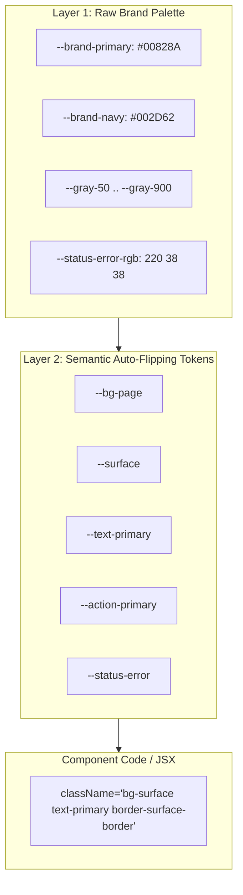

# UX Style Documentation & Two-Layer Design Tokens

This skill defines and documents a production-ready **Two-Layer CSS Custom Property Token Architecture** and creates a single-source-of-truth `DESIGN.md` file for any web prototype.

Two modes populate Layer 1, same Layer 2 shape either way:
- **default** — placeholder palette, for a new prototype with no real brand yet.
- **forge** — cast a real brand's colors/fonts/spacing into the architecture, from a live site, brand guide, or verified hex values. Use for a new prototype with a real brand ready, or to rebrand an existing one.

---

## The Two-Layer Token Architecture



### Layer 1: Raw Brand Palette
- Defined once at `:root`: raw hex codes and RGB triplets for the brand's color palette, gray scales, font families, and status hues.
- **Rule**: Component JSX *never* references Layer 1 classes directly.

### Layer 2: Semantic Roles (Auto-Flipping)
- Defined in `:root` (Light theme) and re-bound under `.dark` (Dark theme).
- Token names represent UI roles (`bg-page`, `surface`, `text-primary`, `surface-border`, `action-primary`). See [`references/token-spec.md`](references/token-spec.md) for the default value matrix and [`references/semantic-role-mold.md`](references/semantic-role-mold.md) for the full, fixed role list — every prototype in this suite binds these exact names; `audit` and `storybook` assume this shape.
- **The Golden Rule**: One semantic class automatically renders correctly in both light and dark modes without manual `dark:` overrides!
- **Dark mode scope**: rebind under a global `.dark` class on `<html>`/`<body>` by default. If a prototype needs a component-scoped theme (e.g. a dashboard region that stays dark regardless of app theme), scope the rebind to that component's root class instead (`.my-widget.theme-dark`) rather than the global `.dark`, but keep it the exception, not the default.
- **No exceptions for status colors**: every status role (`status-success`, `status-error`, etc.) must be a real semantic token, never a raw Tailwind palette class (`bg-red-50`, `text-amber-800`) with a hand-written `dark:` pair. That reintroduces exactly the maintenance burden Layer 2 exists to remove.

---

## Process

### Step 1: Establish Layer 1 & Layer 2 in `src/index.css`

Two paths in, same destination — a complete two-layer token block in `index.css`. Pick based on whether a real brand exists yet.

#### Default mode — placeholder palette
Generate the complete token block in `index.css`:
```css
:root {
  /* Layer 1: Raw Palette */
  --brand-primary: #00828A;
  --brand-primary-hover: #00686E;
  --brand-accent: #00C0F3;
  --gray-50: #F9FAFB;
  --gray-100: #F3F4F6;
  --gray-200: #E5E7EB;
  --gray-800: #1F2937;
  --gray-900: #111827;

  /* Status Colors in RGB triplets for Tailwind opacity support */
  --status-success-rgb: 22 163 74;
  --status-error-rgb: 220 38 38;
  --status-warning-rgb: 217 119 6;
  --status-info-rgb: 37 99 235;

  /* Layer 2: Semantic Tokens (Light Mode) */
  --bg-page: var(--gray-50);
  --surface: #FFFFFF;
  --surface-hover: var(--gray-100);
  --surface-border: var(--gray-200);
  --text-primary: var(--gray-900);
  --text-secondary: #4B5563;
  --text-muted: #9CA3AF;
  --action-primary: var(--brand-primary);
  --action-primary-hover: var(--brand-primary-hover);
  --action-primary-active: #00565A;
  --shadow-card: 0 1px 2px 0 rgb(0 0 0 / 0.05);
  --shadow-hover: 0 4px 12px 0 rgb(0 0 0 / 0.08);
  --scrollbar-thumb: var(--gray-200);
}

.dark {
  /* Layer 2 Rebound (Dark Mode) */
  --bg-page: #0B0F19;
  --surface: #111827;
  --surface-hover: #1F2937;
  --surface-border: #374151;
  --text-primary: #F9FAFB;
  --text-secondary: #9CA3AF;
  --text-muted: #6B7280;
  --action-primary: var(--brand-accent);
  --action-primary-hover: #38BDF8;
  --action-primary-active: #0284C7;
  --shadow-card: 0 1px 2px 0 rgb(0 0 0 / 0.3);
  --shadow-hover: 0 4px 12px 0 rgb(0 0 0 / 0.4);
  --scrollbar-thumb: #374151;
}
```
For a bolder, marketing-forward brand, use a numbered elevation ladder instead (`--shadow-level1..5`, same for `--radius-level1..5`) mapped into `tailwind.config.js`'s `boxShadow`/`borderRadius`. Pick one convention per prototype; don't mix both.

#### Forge mode — cast a real brand
`references/semantic-role-mold.md` is the fixed list of semantic roles every prototype in this suite binds. Forge mode casts a specific brand's raw values into that exact mold: Layer 1 (the brand's own palette) is new every time, Layer 2 (the role names) never changes shape. Component code never sees the difference — it only ever references the semantic roles.

1. **Find the brand's real sources.**
   - Ask what's available: a live site to pull CSS from, a brand guide (PDF/Figma/doc), or hex codes/font names typed directly.
   - **Verified beats provided.** If a live site is available, prefer grepping its actual CSS for real class-based color/spacing values over trusting a brand guide's stated values blindly — a guide can be stale or aspirational relative to what's actually shipped.
   - **If sources conflict** (a brand guide states one hex, the live site renders another), don't silently pick one — ask the user which is authoritative. Guessing here corrupts the one thing this exercise exists to get right.
   - If tints/shades (lighter/light/dark/foundational) aren't supplied for a color and can't be found in a live source, either ask for them or derive them via consistent HSL-lightness steps, and if derived, label them "computed, not brand-verified" in `DESIGN.md`. Don't present a guess as a fact.
   - **Completion criterion:** every hex value about to be written into `index.css` traces to either a verified source or an explicitly labeled computation. None are silently invented.

2. **Cast Layer 1, the raw palette.**
   - Build a color matrix with at minimum: a primary hue family (with tiers), a secondary/neutral corporate color, a gray scale, and four status colors (error/success/warning/info). Add `pending`/`neutral` status variants too if the app has workflow-state badges beyond those four. Also capture the brand's font stack and, if a live site is available, its real spacing rhythm (grep actual padding/margin/gap values; don't assume a generic 8px scale applies without checking).
   - **Completion criterion:** every role the semantic mold requires a raw value for (primary + tiers, secondary, gray scale, status set) has a same-shaped brand value. No role silently dropped.

3. **Rebind Layer 2, the roles.**
   - Open [`references/semantic-role-mold.md`](references/semantic-role-mold.md) and rebind every semantic variable listed there to the new Layer 1 values, using the *same role each one already plays*, in `index.css`'s `:root` (light) and `.dark` (dark) blocks. Do not rename, add, or drop a role — that shape is what `audit` and `storybook` assume across every prototype in this suite:
     - `bg-page`, `surface`, `surface-hover`, `surface-border` → the new gray scale
     - `text-primary`, `text-secondary`, `text-muted`, `text-brand` → the new grays + secondary accent
     - `action-primary` (+`-hover`/`-active`), `action-secondary`, `action-accent` (+`-foreground`), `focus-ring` → the new primary/secondary/accent hues
     - `border-input`, `border-emphasis` → the new gray scale
     - `status-error`/`-success`/`-warning`/`-info` (+`-pending`/`-neutral` if added) and their `-text` pairs, **as RGB triplets, not hex**, this is what lets Tailwind opacity modifiers (`bg-status-success/15`) work
   - **Completion criterion:** `index.css` has one CSS variable for every role in `semantic-role-mold.md`, in both `:root` and `.dark`, new brand values, same names. A renamed or missing role breaks every component that references it.

Whichever mode populated `index.css`, continue to Step 2.

### Step 2: Mirror Tokens in Tailwind Config (`tailwind.config.js`)
Wire semantic color names to CSS variables so developers write `bg-surface`, `text-primary`, `bg-status-success/15`.

### Step 3: Generate `DESIGN.md`
Generate `DESIGN.md` per the exact spec in [`references/design-md-template.md`](references/design-md-template.md): YAML frontmatter with machine-readable tokens, then eight markdown sections in fixed canonical order. `index.css` is the source of truth; `DESIGN.md` is its generated summary. Regenerate on every `index.css` change rather than hand-editing it out of sync.

### Step 4: Verify the cast (forge mode only)
1. `grep -rn "#[0-9a-fA-F]\{3,6\}\b" src/` (or the prototype's component source root) for hardcoded hex outside `index.css`. Any hit bypassed the semantic layer and needs fixing before this counts as done.
2. Cross-check every role in `semantic-role-mold.md` resolves to a CSS var in `index.css` and a Tailwind key in `tailwind.config.js`.
3. Spot-check a handful of components in both light and dark mode; a role that's present but wired to the wrong tier (e.g. `text-muted` reading as illegible on `surface` in dark mode) won't show up in a grep.

**Completion criterion:** both checks in this step return clean, and the prototype renders correctly in both themes with the new brand, no leftover reference to the previous palette anywhere in component code.

If a decision needed for `DESIGN.md` (a color's intended character, a component's philosophy) can't be inferred from the code and isn't already answered, append it to `docs/UNKNOWNS.md` rather than inventing an answer; see AGENTS.md §2.6.
