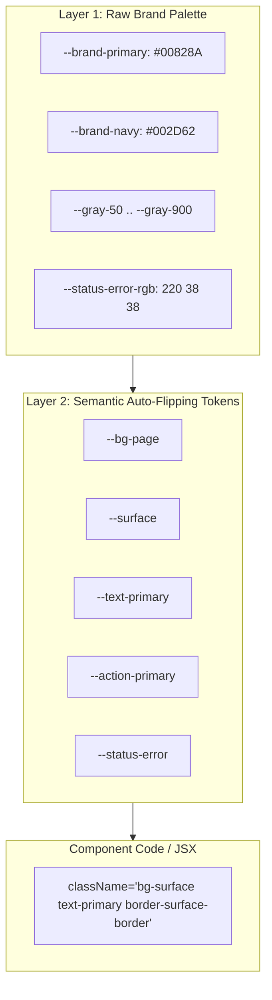

# UX Style Documentation & Two-Layer Design Tokens

This skill defines and documents a production-ready **Two-Layer CSS Custom Property Token Architecture** and creates a single-source-of-truth `DESIGN.md` file for any web prototype.

---

## The Two-Layer Token Architecture



### Layer 1: Raw Brand Palette
- Defined once at `:root`: raw hex codes and RGB triplets for the brand's color palette, gray scales, font families, and status hues.
- **Rule**: Component JSX *never* references Layer 1 classes directly.

### Layer 2: Semantic Roles (Auto-Flipping)
- Defined in `:root` (Light theme) and re-bound under `.dark` (Dark theme).
- Token names represent UI roles (`bg-page`, `surface`, `text-primary`, `surface-border`, `action-primary`). See [`references/token-spec.md`](references/token-spec.md) for the full role list.
- **The Golden Rule**: One semantic class automatically renders correctly in both light and dark modes without manual `dark:` overrides!
- **Dark mode scope**: rebind under a global `.dark` class on `<html>`/`<body>` by default. If a prototype needs a component-scoped theme (e.g. a dashboard region that stays dark regardless of app theme), scope the rebind to that component's root class instead (`.my-widget.theme-dark`) rather than the global `.dark`, but keep it the exception, not the default.
- **No exceptions for status colors**: every status role (`status-success`, `status-error`, etc.) must be a real semantic token, never a raw Tailwind palette class (`bg-red-50`, `text-amber-800`) with a hand-written `dark:` pair. That reintroduces exactly the maintenance burden Layer 2 exists to remove.

---

## Process

### Step 1: Define CSS Custom Properties (`src/index.css`)
Generate the complete token block in `index.css`:
```css
:root {
  /* Layer 1: Raw Palette */
  --brand-primary: #00828A;
  --brand-primary-hover: #00686E;
  --brand-accent: #00C0F3;
  --gray-50: #F9FAFB;
  --gray-100: #F3F4F6;
  --gray-200: #E5E7EB;
  --gray-800: #1F2937;
  --gray-900: #111827;

  /* Status Colors in RGB triplets for Tailwind opacity support */
  --status-success-rgb: 22 163 74;
  --status-error-rgb: 220 38 38;
  --status-warning-rgb: 217 119 6;
  --status-info-rgb: 37 99 235;

  /* Layer 2: Semantic Tokens (Light Mode) */
  --bg-page: var(--gray-50);
  --surface: #FFFFFF;
  --surface-hover: var(--gray-100);
  --surface-border: var(--gray-200);
  --text-primary: var(--gray-900);
  --text-secondary: #4B5563;
  --text-muted: #9CA3AF;
  --action-primary: var(--brand-primary);
  --action-primary-hover: var(--brand-primary-hover);
  --action-primary-active: #00565A;
  --shadow-card: 0 1px 2px 0 rgb(0 0 0 / 0.05);
  --shadow-hover: 0 4px 12px 0 rgb(0 0 0 / 0.08);
  --scrollbar-thumb: var(--gray-200);
}

.dark {
  /* Layer 2 Rebound (Dark Mode) */
  --bg-page: #0B0F19;
  --surface: #111827;
  --surface-hover: #1F2937;
  --surface-border: #374151;
  --text-primary: #F9FAFB;
  --text-secondary: #9CA3AF;
  --text-muted: #6B7280;
  --action-primary: var(--brand-accent);
  --action-primary-hover: #38BDF8;
  --action-primary-active: #0284C7;
  --shadow-card: 0 1px 2px 0 rgb(0 0 0 / 0.3);
  --shadow-hover: 0 4px 12px 0 rgb(0 0 0 / 0.4);
  --scrollbar-thumb: #374151;
}
```

For a bolder, marketing-forward brand, use a numbered elevation ladder instead (`--shadow-level1..5`, same for `--radius-level1..5`) mapped into `tailwind.config.js`'s `boxShadow`/`borderRadius`. Pick one convention per prototype; don't mix both.

### Step 2: Mirror Tokens in Tailwind Config (`tailwind.config.js`)
Wire semantic color names to CSS variables so developers write `bg-surface`, `text-primary`, `bg-status-success/15`.

### Step 3: Generate `DESIGN.md`
Generate `DESIGN.md` per the exact spec in [`references/design-md-template.md`](references/design-md-template.md): YAML frontmatter with machine-readable tokens, then eight markdown sections in fixed canonical order. `index.css` is the source of truth; `DESIGN.md` is its generated summary. Regenerate on every `index.css` change rather than hand-editing it out of sync.

If a decision needed for `DESIGN.md` (a color's intended character, a component's philosophy) can't be inferred from the code and isn't already answered, append it to `docs/UNKNOWNS.md` rather than inventing an answer; see AGENTS.md §2.6.
