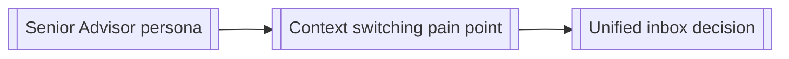

# Knowledge Wiki

Raw notes get re-read from scratch every time they're needed. This skill instead **compiles** them into a small set of interlinked, up-to-date pages — automating the bookkeeping (cross-referencing, catching contradictions, keeping pages current), not the thinking.

**Tool-agnostic by design**: plain markdown files cross-referenced with standard `[text](file.md)` links — and `[text](file.md#section)` for a specific section — not Obsidian-only `[[wikilink]]` syntax. Standard links render and stay clickable in Obsidian, GitHub, VS Code, and any other markdown tool, so a teammate can read, grep, and search this wiki with nothing but a text editor, consistent with this suite's self-containment principle (AGENTS.md §2.5). It lives inside `docs/notes/`, the project's general notes home, so pointing Obsidian (or any other markdown editor) at `docs/notes/` to work outside the IDE also opens the wiki; the wiki just doesn't depend on it.

Two modes, same destination:
- **`compile`** (default) — the full pass: ingest every unprocessed source, answer a query, lint for contradictions/staleness, regenerate the graph view.
- **`note`** — the lowest-ceremony capture in the suite: append a quick thought and immediately fold just that one entry into the wiki (`compile` mode's own Step 1), skipping the periodic lint/visualize steps. Use for jotting something down mid-task without stopping to formalize it as an ADR or a full entity page.

## Structure

```
docs/notes/
  my-notes/
    README.md             # pre-created by setup, explains the format below
    YYYY-MM-DD.md          # raw unprocessed captures: from note mode, or typed by hand
  wiki/
    README.md              # pre-created by setup, "about this wiki" + manual-edit notes
    index.md              # content-oriented catalog, organized by category
    log.md                 # append-only chronological record of what changed and when
    entities/              # one page per durable "thing" worth its own file
      <slug>.md
    constellation.html     # standalone interactive graph view (see Step 4)
```

`my-notes/` and `wiki/` themselves are pre-created by [`setup`](../setup/SKILL.md), each with just a `README.md` explaining the folder — not the same as `wiki`'s own output existing yet. `index.md`, `log.md`, `entities/`, and `constellation.html` still only appear once this skill actually has something to put in them (first `note`-mode capture, or `compile` mode's first real ingest); don't treat the pre-created `README.md` as a sign the wiki is already populated.

`my-notes/` sits next to `wiki/`, not inside it: it's the project's general capture zone, and the wiki reads from it without owning it — most people will edit files there directly in their own markdown editor rather than through `note` mode, so both paths into it need to stay equally valid. Other things worth knowing about live outside `docs/notes/` entirely, straight in `docs/`: specs, transcripts, research write-ups, or whatever else a teammate, PM, client, or user handed over that this suite didn't produce itself. Step 0 covers both.

An **entity** is anything that comes up more than once and benefits from a stable home: a persona, a recurring decision topic, a domain term, a recurring pain point. Don't create an entity page for something mentioned once; that's noise, not knowledge. Use [`references/entity-page-template.md`](references/entity-page-template.md) as the shape for each one.

## Mode: compile (default)

### Step 0: Check for unprocessed sources

Before anything else, scan two places for anything not yet referenced in `log.md`:

- **`docs/notes/my-notes/`**: files (or entries within a dated file) from `note` mode's quick captures, or typed directly into a file by hand with no AI involved. `note` mode already does this same check before every capture; `compile` mode repeats it here so a full run never misses something sitting there between `note` calls.
- **The rest of `docs/`**: any file that isn't one of this suite's own owned docs (check the doc-ownership list in the project's `AGENTS.md`) and isn't already reflected in `index.md`. This is where a spec, a meeting transcript, client feedback, or user research someone else dropped in shows up. It doesn't need to go through `note` mode first; a file placed directly in `docs/` is a source in its own right.

Ingest anything unprocessed the same way as any other source (Step 1 below), crediting hand-typed or externally-provided entries as such rather than assuming they came through `note` mode.

### Step 1: Ingest a source

When adding a new source (a `my-notes/` entry, an external document dropped into `docs/`, an interview synthesis from [`interview`](../interview/SKILL.md), an `audit` finding, a resolved `docs/UNKNOWNS.md` item, a meeting note, a `decisions` ADR that doesn't fit as a formal record but is still worth knowing):

1. Read the source. Identify which existing entity pages it touches, and whether it introduces a new entity.
2. **New entity creation is a gate, not automatic.** If this is genuinely a new durable topic, say so explicitly and use consistent naming with what's already in the wiki (check `index.md` first) rather than creating a near-duplicate page under a slightly different name.
3. Update every touched entity page: add the new information, and if it contradicts something already written, flag the contradiction inline (`> ⚠️ Conflicts with earlier note in [Other Entity](other-entity.md), needs resolution`) rather than silently overwriting. **For an external document**, summarize and link to it (a relative path, e.g. `[client feedback](../client-feedback.md)`) rather than copying its full content into the entity page; the wiki indexes and cross-references, it doesn't need to own a second copy of a doc someone else maintains.
4. Update `index.md` with any new/changed entries.
5. Append one line to `log.md`: `## [YYYY-MM-DD] ingest, <source>, touched: [Entity A](entities/entity-a.md), [Entity B](entities/entity-b.md)`.

### Step 2: Query the wiki

When a question comes up that the wiki might already answer, search `index.md` and relevant entity pages before starting from scratch. If the answer required real synthesis (not just a direct lookup), file it back into the relevant entity page — this is what makes the wiki compound in value instead of staying flat.

### Step 3: Periodic linting

Every so often (natural checkpoints: after an `audit`, before a `package` handoff, or whenever the wiki feels stale), run a health check:
- **Contradictions**: pages that disagree with each other on the same fact.
- **Staleness**: pages that reference a screen, feature, or decision that's since changed (cross-check against current `docs/OOUX_OBJECT_MAP.md` / `DESIGN.md` / `docs/adr/`).
- **Orphans**: entity pages nothing links to and that don't appear in `index.md`.
- **Gaps**: a topic referenced repeatedly across sources that still has no entity page.
- **Unindexed docs**: files anywhere under `docs/` that aren't owned by another skill and aren't referenced from any entity page or `index.md` yet, i.e. Step 0's second check turned up something and it never actually got ingested.

Report findings, don't silently fix everything. A contradiction usually needs a human call on which version is current.

### Step 4: Visualize

The wiki's entities and the links between their pages are already a graph. Every ingest should keep this current, not just the pages themselves.

**Mermaid graph** (for embedding in `index.md` or any doc): one node per entity, one edge per cross-reference link between them:



**`constellation.html`**: a standalone, self-contained interactive graph view, separate from the Mermaid diagram because it needs to support click-to-explore (unlike a static Mermaid embed). Build it as a single HTML file with an inline Vis.js network (same library and interaction pattern as [`map`](../map/SKILL.md)'s `site` mode modal, but standalone rather than embedded in a running prototype: open it directly in a browser, no dev server or app required). Entity pages become nodes, their cross-reference links become edges, clicking a node shows that entity's summary. Regenerate it during the periodic linting pass (Step 3), not on every single ingest — it's a snapshot view, not a live one.

**Completion criterion:** every entity page is reachable from `index.md`, every ingest leaves a `log.md` line, and no two pages state contradictory facts without an explicit `⚠️ Conflicts` flag.

## Mode: note

The lowest-ceremony capture point in the suite. A thought worth keeping but not worth stopping to formalize: [`decisions`](../decisions/SKILL.md) is for a real ADR (a rejected alternative, a permanent record); `compile` mode above is for the deeper ingest-everything pass; `docs/UNKNOWNS.md` is for a question genuinely blocking on input this session doesn't have. `note` mode is for everything else worth not losing.

**Not this mode:**
- A non-obvious decision with a rejected alternative → [`decisions`](../decisions/SKILL.md).
- A question that needs real user/stakeholder input to resolve → `docs/UNKNOWNS.md` directly (see AGENTS.md §2.6).
- The periodic lint/contradiction-check/constellation-regen pass → `compile` mode's own Step 3 and Step 4, which `note` mode never runs.

### Step 1: Write the entry

`docs/notes/my-notes/` should already exist (with just a `README.md`) from `setup` — this is normally the first *content* file in it, not the first thing in the folder. If the folder genuinely doesn't exist yet (a project that predates this convention, or `setup` never ran), create it now, along with `docs/notes/` itself if that's missing too — see `setup`'s SKILL.md for both folders' README templates.

Append the thought, verbatim, to today's file: `docs/notes/my-notes/YYYY-MM-DD.md`, under a timestamped bullet. Create the file if today doesn't have one yet. No required structure beyond the timestamp; freeform is the point.

### Step 2: Fold it into the wiki immediately

Run `compile` mode's **Step 1 (Ingest a source)** now, treating this entry as the source: identify which entity page(s) it touches or whether it's a new entity, update them (creating `docs/notes/wiki/index.md`, `log.md`, and `entities/` if this is the wiki's very first entity), and append the `log.md` line referencing the `my-notes/` file. Don't run `compile` mode's Step 3 (periodic linting) or Step 4 (constellation regen) here; those stay `compile` mode's own periodic job, not something every note triggers.

### Step 3: Notes written by hand

A person can create or edit a file directly in `docs/notes/my-notes/` in a plain text editor, no AI involved — that's why it's kept a sibling of `wiki/` rather than buried inside the compiled output. Before starting any new `note`-mode capture, check `docs/notes/my-notes/` for files not yet referenced in `log.md` and ingest those too, the same way, crediting the source as "added by hand" rather than assuming it came through this mode. `compile` mode's own runs do this same check.

### Step 4: Say what happened

Tell the user which entity page(s) got created or updated, so the capture visibly compounds into the wiki rather than disappearing into a file.

**Completion criterion:** the note exists verbatim in `docs/notes/my-notes/` (nothing lost even if the fold-in mis-files it) and is reflected in `docs/notes/wiki/index.md` / the relevant entity page / `log.md`, not left sitting unprocessed.
