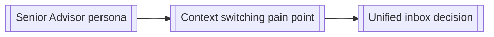

# Knowledge Wiki

Most note-taking produces a pile of raw files that get re-read from scratch every time they're needed. This skill instead **compiles** notes into a small set of interlinked, up-to-date pages. The tedious part of a knowledge base isn't the thinking, it's the bookkeeping (cross-referencing, catching contradictions, keeping pages current), and that's exactly the part this skill automates.

**Tool-agnostic by design**: plain markdown files with `[[wikilink]]`-style cross-references. Nothing here requires Obsidian or any specific app; a teammate can read, grep, and search this wiki with nothing but a text editor, consistent with this suite's self-containment principle (AGENTS.md §2.5). It lives inside `docs/notes/`, the project's general notes home, so if you personally use Obsidian (or any other markdown editor) to work outside the IDE, pointing it at `docs/notes/` opens the wiki too; the wiki just doesn't depend on it.

## Structure

```
docs/notes/
  my-notes/               # raw unprocessed captures: from note, or typed by hand
    YYYY-MM-DD.md
  wiki/
    index.md              # content-oriented catalog, organized by category
    log.md                 # append-only chronological record of what changed and when
    entities/              # one page per durable "thing" worth its own file
      <slug>.md
    constellation.html     # standalone interactive graph view (see Step 4)
```

`my-notes/` sits next to `wiki/`, not inside it: it's the project's general capture zone (see [`note`](../note/SKILL.md) and `docs/notes/README.md`), and the wiki is one thing that reads from it, not its owner. Other things worth knowing about routinely live outside `docs/notes/` entirely, straight in `docs/`: specs, transcripts, research write-ups, or whatever else a teammate, PM, client, or user handed over that this suite didn't produce itself. Step 0 covers both.

An **entity** is anything that comes up more than once and benefits from a stable home: a persona, a recurring decision topic, a domain term, a recurring pain point. Don't create an entity page for something mentioned once; that's noise, not knowledge. Use [`references/entity-page-template.md`](references/entity-page-template.md) as the shape for each one.

## Step 0: Check for unprocessed sources

Before anything else, scan two places for anything not yet referenced in `log.md`:

- **`docs/notes/my-notes/`**: files (or entries within a dated file) from [`note`](../note/SKILL.md)'s quick captures, or typed directly into a file by hand with no AI involved at all. `note` already does this same check on its own before every capture; `wiki` repeats it here so a full run never misses something sitting there between `note` calls.
- **The rest of `docs/`**: any file that isn't one of this suite's own owned docs (check the doc-ownership list in the project's `AGENTS.md`) and isn't already reflected in `index.md`. This is where a spec, a meeting transcript, client feedback, or user research someone else dropped in shows up. Don't require it to go through `note` first; a file placed directly in `docs/` is a source in its own right.

Ingest anything unprocessed the same way as any other source (Step 1 below), crediting hand-typed or externally-provided entries as such rather than assuming they came through `note`.

## Step 1: Ingest a source

When adding a new source (a `my-notes/` entry, an external document dropped into `docs/`, an interview synthesis from [`interview`](../interview/SKILL.md), an `audit` finding, a resolved `docs/UNKNOWNS.md` item, a meeting note, a `decisions` ADR that doesn't fit as a formal record but is still worth knowing):

1. Read the source. Identify which existing entity pages it touches, and whether it introduces a new entity.
2. **New entity creation is a gate, not automatic.** If this is genuinely a new durable topic, say so explicitly and use consistent naming with what's already in the wiki (check `index.md` first) rather than creating a near-duplicate page under a slightly different name.
3. Update every touched entity page: add the new information, and if it contradicts something already written, flag the contradiction inline (`> ⚠️ Conflicts with earlier note in [[other-entity]], needs resolution`) rather than silently overwriting. **For an external document**, summarize and link to it (a relative path, e.g. `[client feedback](../client-feedback.md)`) rather than copying its full content into the entity page; the wiki indexes and cross-references, it doesn't need to own a second copy of a doc someone else maintains.
4. Update `index.md` with any new/changed entries.
5. Append one line to `log.md`: `## [YYYY-MM-DD] ingest, <source>, touched: [[entity-a]], [[entity-b]]`.

## Step 2: Query the wiki

When a question comes up that the wiki might already answer, search `index.md` and relevant entity pages before starting from scratch. If the answer required real synthesis (not just a direct lookup), file the synthesized answer back into the wiki as part of the relevant entity page. This is what makes the wiki compound in value instead of staying flat.

## Step 3: Periodic linting

Every so often (natural checkpoints: after a `audit`, before a `package` handoff, or whenever the wiki feels stale), run a health check:
- **Contradictions**: pages that disagree with each other on the same fact.
- **Staleness**: pages that reference a screen, feature, or decision that's since changed (cross-check against current `docs/OOUX_OBJECT_MAP.md` / `DESIGN.md` / `docs/adr/`).
- **Orphans**: entity pages nothing links to and that don't appear in `index.md`.
- **Gaps**: a topic referenced repeatedly across sources that still has no entity page.
- **Unindexed docs**: files anywhere under `docs/` that aren't owned by another skill and aren't referenced from any entity page or `index.md` yet, i.e. Step 0's second check turned up something and it never actually got ingested.

Report findings, don't silently fix everything. A contradiction usually needs a human call on which version is current.

## Step 4: Visualize

The wiki's entities and `[[wikilinks]]` are already a graph. Every ingest should keep this current, not just the pages themselves.

**Mermaid graph** (for embedding in `index.md` or any doc): one node per entity, one edge per `[[wikilink]]` between them:



**`constellation.html`**: a standalone, self-contained interactive graph view, separate from the Mermaid diagram because it needs to support click-to-explore (unlike a static Mermaid embed). Build it as a single HTML file with an inline Vis.js network (same library and interaction pattern as [`map`](../map/SKILL.md)'s `site` mode modal, but standalone rather than embedded in a running prototype: open it directly in a browser, no dev server or app required): entity pages become nodes, wikilinks become edges, clicking a node shows that entity's summary. Regenerate it as part of the periodic linting pass (Step 3), not on every single ingest. It's a snapshot view, not a live one.

**Completion criterion:** every entity page is reachable from `index.md`, every ingest leaves a `log.md` line, and no two pages state contradictory facts without an explicit `⚠️ Conflicts` flag.
